<div align="center">

<picture>
  <source media="(prefers-color-scheme: dark)"  srcset="docs/public/adam-logo-bgai.png">
  <source media="(prefers-color-scheme: light)" srcset="docs/public/adam-logo-bga.png">
  
</picture>

> A physics-agnostic Fortran SDK for adaptive grids, and its solvers, from a laptop to GPU clusters

### *A*ccelerated fluid *D*ynamics on *A*daptive *M*esh refinement grids

[](https://github.com/szaghi/adam/releases/latest)
[](https://github.com/szaghi/adam/actions/workflows/ci.yml)
[](https://szaghi.github.io/adam/)
[](https://opensource.org/licenses/MIT)
[](https://www.gnu.org/licenses/lgpl-3.0)

[Documentation](https://szaghi.github.io/adam/) · [Install](https://szaghi.github.io/adam/start/install) · [FLUME](https://szaghi.github.io/adam/applications/flume/) · [PRISM](https://szaghi.github.io/adam/applications/prism/) · [Citing](https://szaghi.github.io/adam/project/citing)

</div>

---

**ADAM** is a modern Fortran library for block-structured adaptive grids — Morton-ordered octree/quadtree AMR, immersed
boundaries, WENO reconstruction, Runge-Kutta integration, the FLAIL elliptic solvers and parallel I/O — with a CPU
backend (MPI, OpenMP) and a GPU backend (OpenACC with nvfortran, or OpenMP offloading with amdflang). Solvers are built
on it by supplying their equations. Two are maintained:

- **[FLUME](https://szaghi.github.io/adam/applications/flume/)** — compressible Euler and ideal MHD, with dissipative terms, gravity,
  self-gravity, cooling and sink particles;
- **[PRISM](https://szaghi.github.io/adam/applications/prism/)** — Maxwell equations with particle-in-cell plasmas.

## Quick start

```bash
git clone https://github.com/szaghi/adam && cd adam
fobis fetch                                             # dependencies
fobis build --mode flume-cpu-gnu                        # FLUME, CPU (gfortran + Open MPI)
fobis build --mode flume-fnl-nvf --varset local_nvf     # FLUME, GPU (nvfortran); pick your machine's varset
cd src/tests/flume/regression/sod-x && mpirun -np 2 ../../../../../exe/adam_flume_cpu input.ini   # a Sod tube
```

Toolchains, HDF5 and the varsets are on the [install page](https://szaghi.github.io/adam/start/install); the concepts, the cookbook and the
input references are on the [documentation site](https://szaghi.github.io/adam/).

## License

ADAM is dual-licensed under the [MIT License](LICENSE.mit.md) and the [GNU LGPLv3](LICENSE.lgpl3.md); you may choose
either. If you use ADAM in published work, please [cite it](https://szaghi.github.io/adam/project/citing).
