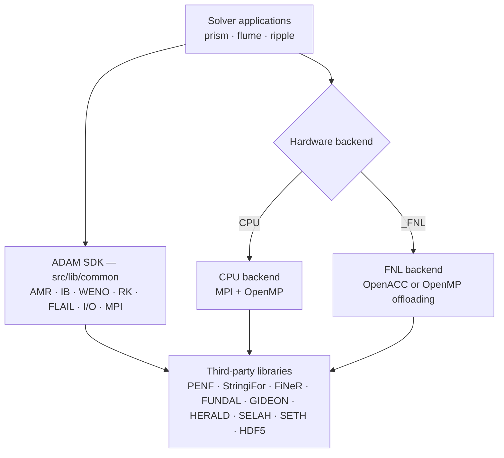
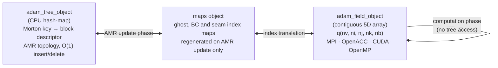

# Architecture

## Overview

ADAM is a **physics-agnostic SDK** for building high-performance CFD solvers. Its core infrastructure — block-structured AMR, immersed boundary method, high-order WENO numerics, Runge-Kutta time integration, and parallel I/O — is fully decoupled from any specific set of governing equations. Solvers are assembled by composing these building blocks and adding only the physics-specific layer on top.

ADAM targets the full spectrum of modern HPC hardware without changing application source code or input files:

- **CPU-based clusters** — MPI distributed-memory parallelism, with optional OpenMP threading (`flume-cpu-gnu-omp`)
- **CPU+GPU accelerated clusters** — the FNL backend: OpenACC with nvfortran (`*-fnl-nvf` modes, NVIDIA GPUs), or the same sources as OpenMP offloading with amdflang (`*-fnl-omp-amd` modes, AMD GPUs); multi-node scaling via MPI with GPU-aware communication

The choice of hardware backend is a compile-time switch; everything above the backend layer — physics, numerics, I/O, configuration — is identical.

| Modes | Macro | Compiler | Parallelism model |
|-------|-------|----------|-------------------|
| `*-cpu-gnu`, `*-cpu-gnu-omp` | — | GNU gfortran | MPI, optional OpenMP threading |
| `*-fnl-nvf` | `_FNL` | NVIDIA nvfortran | OpenACC + FUNDAL memory management (NVIDIA GPUs) |
| `*-fnl-omp-amd` | `_FNL`, `DEV_OMP` | AMD amdflang | OpenMP target offloading + FUNDAL (AMD GPUs) |

The FNL kernels carry both directive sets (`!$acc` and `!$omp` twins). Each application compiles to one executable per
backend from a common source tree under `src/app/<name>/common/`. Tested compiler versions are in
[install](/start/install#supported-compilers).



## SDK Layer — `src/lib`

The SDK provides physics-agnostic building blocks reused identically by every application.

### Core objects (`src/lib/common`)

| Object | Purpose |
|--------|---------|
| `adam_grid_object` | Block-structured grid management with AMR geometry |
| `adam_tree_object` | Octree/quadtree with Morton-order linearization: blocks sorted along the Z-order curve |
| `adam_field_object` | Per-block geometry and metrics, ghost exchange (`update_ghost_local`, `update_ghost_mpi`), refinement/derefinement of the block data, restart blocks (`save_blocks`, `load_blocks`) |
| `adam_weno_object` | The `[weno]` configuration (upwind orders 1, 3, 5, 7, 9, `weno-u-N`, `ngc >= (N+1)/2`; Jiang–Shu `js`, the default, or scale-invariant `si` weights) and the run-time dispatchers over [SETH](https://github.com/szaghi/SETH)'s WENO kernels, the only source of WENO, TENO and hybrid operators ([#139](https://github.com/szaghi/adam/issues/139)); the centred names `weno-c-N` are refused |
| `adam_stepper_object` | Time integration on [SELAH](https://github.com/szaghi/SELAH) ([#132](https://github.com/szaghi/adam/issues/132)): `runge-kutta-1/2/3`, SSP `runge-kutta-ssp-11`, `-22`, `-33`, `-54`, and the symplectic `runge-kutta-yoshida`; the time step comes from the CFL condition |
| `adam_ib_object` | Immersed boundary method: solids on the Cartesian grid as eikonal signed-distance fields, boundary conditions reconstructed at the cut cells; in FLUME an `AMR_GEO_SOLID` marker refines around a solid (PRISM does not implement it); moving bodies are library only |
| `adam_io_object` | `[IO]` configuration, history files (residuals, energy, divergence, charge), the XH5F field writer `save_field`: one HDF5 file per rank plus an XDMF index; restart and slice files in [cookbook IO](/cookbook/io) |
| `mpih` (`adam_mpih_global`) | The MPI handler, an instance of [HERALD](https://github.com/szaghi/HERALD)'s `mpih_object` ([#158](https://github.com/szaghi/adam/issues/158)): ranks and node topology, `error_stop` (every rank stops), barrier, the host memory budget (`host_memory_avail()` for the block capacity), timers |
| `adam_flail_object` | FLAIL, the elliptic solver library: a facade over the FFT (`adam_poisson_fft_object`) and AMR multigrid (`adam_poisson_mg_object`) Poisson solvers |
| GIDEON (`use gideon`) | The finite difference/volume operators (derivatives, face values, curl, divergence, gradient), [GIDEON](https://github.com/szaghi/GIDEON)'s since [#159](https://github.com/szaghi/adam/issues/159) |
| `adam_riemann_euler_library` | Riemann solvers for the Euler equations (library only: used by no maintained application) |

### Object ownership: the realm

Every library object belongs to a **realm** — the per-domain solver instance — as a component of `realm_object` (`src/lib/common/adam_realm_object.F90`), from which every application type inherits:

| Component | Type | Role |
|-----------|------|------|
| `adam` | `adam_object` | owns `grid`, `tree`, `field`, `maps` as value components |
| `io` | `io_object` | INI file handle, output/restart configuration |
| `amr` | `amr_object` | refinement markers |
| `weno`, `ts`, `ib` | `weno_object`, `stepper_object`, `ib_object` | reconstruction, time integration (SELAH), immersed boundary |
| `slices`, `flail` | … | slices output, the FLAIL elliptic solver library (FFT and multigrid Poisson solvers) |

Library routines that need another object receive it **as an argument**, e.g. `call self%adam%field%update_ghost_local(grid=self%adam%grid, maps=self%adam%maps, q=q)`. Because each realm owns its objects, several realms (a multi-realm *forest*) coexist in one process without sharing state.

The only program-scope singleton is the MPI handler, genuinely one per process: `mpih` (`adam_mpih_global`, [HERALD](https://github.com/szaghi/HERALD)'s `mpih_object`). On the FNL backend it also binds the rank to its device, once per process (`bind_device`, [#158](https://github.com/szaghi/adam/issues/158)).

### FNL initialization order

MPI and the device are process-global: the forest initializes them once, before any realm, through the realm hook `initialize_process_context` (the mirror of `finalize_mpi_forest`); a realm never initializes them itself. FNL helpers (`field_fnl`, `ib_fnl`, and app-specific ones such as PRISM's `coil_fnl`; no WENO helper since [#139](https://github.com/szaghi/adam/issues/139)) are components of the application's FNL type, one set per realm. They are initialised **after** the common (CPU) initialisation, from the realm's own objects:

```fortran
! the forest, once per process, before any realm (adam_forest_object.F90)
call realm(1)%ptr%initialize_process_context(verbose=.true.)
! FNL backends override it (e.g. adam_prism_fnl_object.F90): mpih and the device binding
call bind_device(verbose=verbose)     ! adam_fnl_device: HERALD binds the device (mpih%device), then FUNDAL's dev_init
! then, per realm, prism_fnl_object%initialize_prism (adam_prism_fnl_object.F90)
call self%prism_common_object%initialize(filename=filename, memory_avail=memory_avail_, verbose=.true.)
call self%field_fnl%initialize(grid=self%adam%grid, field=self%adam%field, maps=self%adam%maps, verbose=.true.)
call self%ib_fnl%initialize(grid=self%adam%grid, field=self%adam%field, ib=self%ib)
```

### Backend libraries

The FNL objects do not extend the common ones: each is a plain type (e.g. `field_fnl_object`) holding the device data, initialised from the realm's common objects passed as arguments.

| Directory | Backend | Parallelism model |
|-----------|---------|-------------------|
| `src/lib/common` | CPU | MPI + OpenMP |
| `src/lib/fnl` | FNL | OpenACC (nvfortran, NVIDIA GPUs) or OpenMP offloading (amdflang, AMD GPUs), device memory through FUNDAL |
| `src/lib/nvf` | NVF | CUDA Fortran; no build mode builds it (its only consumer, NASTO NVF, has no mode) |
| `src/lib/gmp` | GMP | OpenMP target offloading; no build mode uses it |

## Application Layer — `src/app`

Applications sit on top of the SDK and contribute only the physics-specific layer. The full HPC stack is inherited for free.

### Directory structure

```
src/
├── lib/                  # ADAM SDK
│   ├── common/           # Physics-agnostic core objects (portable, CPU)
│   ├── fnl/              # GPU backend (OpenACC, or OpenMP offloading on AMD)
│   ├── nvf/              # CUDA Fortran (not built by PRISM or FLUME)
│   └── gmp/              # OpenMP offloading (no build mode)
├── app/                  # Solvers built on the SDK
│   ├── prism/            # Maxwell equations / plasma solver (maintained)
│   ├── flume/            # Compressible Euler and MHD (maintained)
│   ├── ripple/           # Scalar advection: the maintained tutorial application
│   ├── nasto/            # Navier-Stokes solver (unmaintained: predates the realm refactor)
│   ├── chase/            # Euler solver (unmaintained, superseded by FLUME)
│   ├── patch/            # Patch-based application (unmaintained)
│   └── ascot/            # Binary-to-ASCII output converter
├── tests/                # Unit and integration tests
└── third_party/          # Dependencies fetched by `fobis fetch` (PENF, StringiFor, FiNeR, VTKFortran, …)
```

### Backend pattern

PRISM, FLUME and RIPPLE share the same subdirectory layout:

```
app/<name>/common/    # Physics layer shared across all backends
app/<name>/cpu/       # CPU entry point (MPI, optional OpenMP)
app/<name>/fnl/       # GPU entry point (OpenACC, or OpenMP offloading on AMD)
```

### Adding a new solver

A new application extends `realm_object` and supplies only its physics; the time loop is the library's
`forest_object%simulate`. RIPPLE (`src/app/ripple`), a scalar advection solver, is written to show it layer by layer:
see [build your own solver](/tutorials/build-your-own/core).

## AMR data design: inverse indexing

High-performance AMR requires resolving a fundamental tension: the grid topology changes dynamically at runtime (refinement, coarsening, load rebalancing), yet the numerical kernels must operate on dense, contiguous memory with no indirection overhead. ADAM resolves this by splitting the AMR data into two structurally opposite objects with complementary roles.

### Tree — flexible topology on the CPU

`adam_tree_object` is a **hash-map living entirely in CPU memory**. Its keys are 64-bit Morton indices that linearise the four octree coordinates `(level, bx, by, bz)` into a single integer; its values are lightweight block descriptor objects. This structure provides:

- **O(1) insertion and deletion** of blocks during refinement and coarsening steps
- **O(1) neighbour lookup** — the Morton key of any face/edge/corner neighbour can be computed arithmetically, with no pointer chasing
- **Spatial locality** — Morton ordering clusters geometrically adjacent blocks in index space, minimising ghost-cell communication volume across MPI ranks

The tree is never touched by numerical kernels. It is only consulted during the AMR update phase (marking → refinement/coarsening → load rebalancing) and to regenerate the index maps needed by the field object.

### Field — contiguous arrays for parallel computing

The state of an application is a **dense, contiguous 5D array**, allocated once by the application (e.g. `flume_common_object%q`) after `realm_object%initialize` has fixed `nb`; `adam_field_object` holds the per-block geometry and the ghost exchange that operate on it:

```
q(nv, 1-ngc:ni+ngc, 1-ngc:nj+ngc, 1-ngc:nk+ngc, nb)
```

| Dimension | Meaning |
|-----------|---------|
| `nv` | Physical variables (density, momenta, energy, …) |
| `ni, nj, nk` | Cell indices within a block, including ghost cells |
| `nb` | Block index — a compact integer from 1 to the current block count |

The block index `nb` is **not** the Morton key. It is a compact sequential integer assigned so that all blocks owned by an MPI rank occupy a contiguous slice of the array. This is the inverse of the tree's hash-map addressing — hence *inverse indexing*: the tree maps Morton keys → block descriptors, while the field maps compact block indices → raw data.

This layout guarantees:
- **Stride-1 access on the innermost dimension** (`nv`) in Fortran column-major order, enabling coalesced reads across CUDA threads or OpenACC/OpenMP SIMD lanes
- **No dynamic allocation during time integration** — the array is pre-allocated to the maximum block count and reused across all Runge-Kutta stages
- **Direct offload to device memory** — one contiguous copy transfers the entire array; no pointer-based scatter/gather is needed

### The mapping layer

Each tree node carries the compact index of its block in the field arrays (`node%block_index`). From it `adam_maps_object` precomputes the index lists the kernels use: local and MPI ghost-cell maps (`local_map_ghost_cell`, `comm_map_send_ghost_cell`, `comm_map_recv_ghost_cell`), boundary-condition maps (`local_map_bc_crown`) and the inter-realm seam maps. They are regenerated only when the topology changes (refinement, coarsening, rebalancing) and are otherwise read-only:

```
node_ptr => tree%node(code)   ! Morton key  → node; node_ptr%block_index is its block (tree → field)
maps%local_map_ghost_cell     ! ghost cell  → source cell, in block indices
```

During the computation phase — which accounts for the overwhelming majority of runtime — kernels iterate over the compact block index `nb` with no hash-map access, achieving the same memory access pattern as a static structured grid.



### Memory and parallelism summary

- **Ghost cells**: configurable width `ngc` (typically 3 for WENO5, 4 for WENO7); exchanged via MPI before each stencil sweep using the compact block index, not Morton keys.
- **AMR conservation (FLUME)**: coarsening restricts by the cell mean, refinement prolongs with a conservative (MC-limited) reconstruction, and the 2:1 faces are refluxed.
- **Load balancing**: blocks are redistributed across MPI ranks by reordering the compact index using Morton space-filling curves, keeping the field array layout optimal after each rebalancing step.
- **Scalability target**: strong scaling to O(1000) GPUs with >70% parallel efficiency.

## Configuration

All applications are configured through human-readable INI files (parsed by FiNeR). No recompilation is needed to change physics, numerics, grid, or I/O settings:

- Grid parameters — domain bounds, resolution, ghost cell width
- Physics parameters — gas properties, Reynolds/Mach numbers
- Numerical parameters — WENO order, Runge-Kutta scheme
- Boundary and initial conditions
- I/O options and AMR refinement criteria
