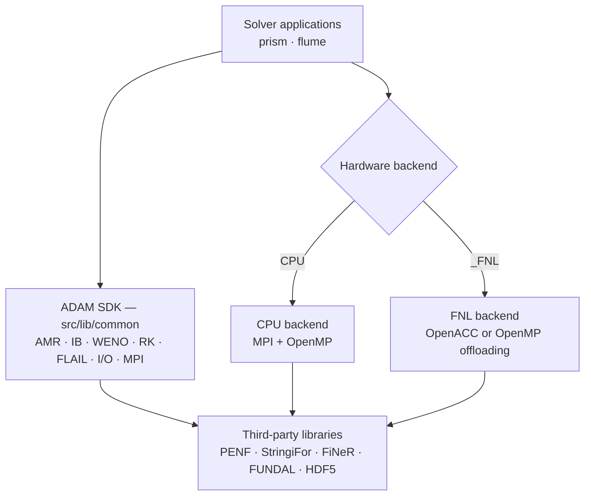
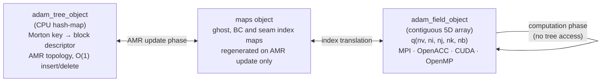

# Architecture

## Overview

ADAM is a **physics-agnostic SDK** for building high-performance CFD solvers. Its core infrastructure — block-structured AMR, immersed boundary method, high-order WENO numerics, Runge-Kutta time integration, and parallel I/O — is fully decoupled from any specific set of governing equations. Solvers are assembled by composing these building blocks and adding only the physics-specific layer on top.

ADAM targets the full spectrum of modern HPC hardware without changing application source code or input files:

- **CPU-based clusters** — MPI distributed-memory parallelism, with optional OpenMP threading (`flume-cpu-gnu-omp`)
- **CPU+GPU accelerated clusters** — the FNL backend: OpenACC with nvfortran (`*-fnl-nvf` modes, NVIDIA GPUs), or the same sources as OpenMP offloading with amdflang (`*-fnl-omp-amd` modes, AMD GPUs); multi-node scaling via MPI with GPU-aware communication

The choice of hardware backend is a compile-time switch; everything above the backend layer — physics, numerics, I/O, configuration — is identical.



## SDK Layer — `src/lib`

The SDK provides physics-agnostic building blocks reused identically by every application.

### Core objects (`src/lib/common`)

| Object | Purpose |
|--------|---------|
| `adam_grid_object` | Block-structured grid management with AMR geometry |
| `adam_tree_object` | Octree/quadtree with Morton-order linearization |
| `adam_field_object` | Per-block geometry and metrics, ghost exchange (`update_ghost_local`, `update_ghost_mpi`), refinement/derefinement of the block data, restart blocks (`save_blocks`, `load_blocks`) |
| `adam_weno_object` | WENO reconstruction: upwind orders 1, 3, 5, 7, 9 (`weno-u-N`), centred orders 2, 4, 6, 8 (`weno-c-N`); Jiang–Shu or scale-invariant weights |
| `adam_rk_object` | Runge-Kutta integration: `runge-kutta-1/2/3`, SSP `11`, `22`, `33`, `54`, and 4-stage symplectic Yoshida |
| `adam_ib_object` | Immersed boundary method with eikonal distance fields |
| `adam_io_object` | `[IO]` configuration, history files (residuals, energy, divergence, charge), the XH5F field writer `save_field` |
| `adam_mpih_object` | MPI wrapper: initialize/finalize, `error_stop`, barrier, timers |
| `adam_flail_object` | FLAIL, the elliptic solver library: a facade over the FFT (`adam_poisson_fft_object`) and AMR multigrid (`adam_poisson_mg_object`) Poisson solvers |
| `adam_fdv_operators_library` | Gradient, divergence, curl, Laplacian finite difference operators |
| `adam_riemann_euler_library` | Riemann solvers for the Euler equations |

### Object ownership: the realm

Every library object belongs to a **realm** — the per-domain solver instance — as a component of `realm_object` (`src/lib/common/adam_realm_object.F90`), from which every application type inherits:

| Component | Type | Role |
|-----------|------|------|
| `adam` | `adam_object` | owns `grid`, `tree`, `field`, `maps` as value components |
| `io` | `io_object` | INI file handle, output/restart configuration |
| `amr` | `amr_object` | refinement markers |
| `weno`, `rk`, `ib` | `weno_object`, `rk_object`, `ib_object` | reconstruction, time integration, immersed boundary |
| `slices`, `flail`, `leapfrog`, `blanesmoan`, `cfm` | … | slices output, the FLAIL elliptic solver library (issue #84: FFT and multigrid Poisson solvers), alternative integrators |

Library routines that need another object receive it **as an argument**, e.g. `call self%adam%field%update_ghost_local(grid=self%adam%grid, maps=self%adam%maps, q=q)`. Because each realm owns its objects, several realms (a multi-realm *forest*) coexist in one process without sharing state.

The only program-scope singletons are the MPI handlers, which are genuinely one per process: `mpih` (`adam_mpih_global`, CPU) and `mpih_fnl` (`adam_fnl_mpih_global`, FNL — it also owns the device context, so it must be initialised exactly once).

### FNL initialization order

FNL helpers (`field_fnl`, `ib_fnl`, `rk_fnl`, `weno_fnl`, and app-specific ones such as PRISM's `coil_fnl`) are components of the application's FNL type, one set per realm. They are initialised **after** the common (CPU) initialisation, from the realm's own objects:

```fortran
! prism_fnl_object%initialize_prism (adam_prism_fnl_object.F90)
if (.not.mpih_fnl_is_initialized) then                                           ! once per process
   call mpih_fnl%initialize(do_mpi_init=..., do_device_init=.true.)
   mpih_fnl_is_initialized = .true.
endif
call self%prism_common_object%initialize(filename=filename, memory_avail=memory_avail_, verbose=.true.)
call self%field_fnl%initialize(grid=self%adam%grid, field=self%adam%field, maps=self%adam%maps, verbose=.true.)
call self%ib_fnl%initialize(grid=self%adam%grid, field=self%adam%field, ib=self%ib)
call self%rk_fnl%initialize(grid=self%adam%grid, field=self%adam%field, rk=self%rk)
call self%weno_fnl%initialize(weno=self%weno)
```

### Backend libraries

The FNL objects do not extend the common ones: each is a plain type (e.g. `field_fnl_object`) holding the device data, initialised from the realm's common objects passed as arguments.

| Directory | Backend | Parallelism model |
|-----------|---------|-------------------|
| `src/lib/common` | CPU | MPI + OpenMP |
| `src/lib/fnl` | FNL | OpenACC (nvfortran, NVIDIA GPUs) or OpenMP offloading (amdflang, AMD GPUs), device memory through FUNDAL |
| `src/lib/nvf` | NVF | CUDA Fortran; no build mode builds it (its only consumer, NASTO NVF, has no mode) |
| `src/lib/gmp` | GMP | OpenMP target offloading; no build mode uses it |

## Application Layer — `src/app`

Applications sit on top of the SDK and contribute only the physics-specific layer. The full HPC stack is inherited for free.

### Directory structure

```
src/
├── lib/                  # ADAM SDK
│   ├── common/           # Physics-agnostic core objects (portable, CPU)
│   ├── fnl/              # GPU backend (OpenACC, or OpenMP offloading on AMD)
│   ├── nvf/              # CUDA Fortran (not built by PRISM or FLUME)
│   └── gmp/              # OpenMP offloading (no build mode)
├── app/                  # Solvers built on the SDK
│   ├── prism/            # Maxwell equations / plasma solver (maintained)
│   ├── flume/            # Compressible Euler and MHD (maintained)
│   ├── nasto/            # Navier-Stokes solver (unmaintained: predates the realm refactor)
│   ├── chase/            # Euler solver (unmaintained, superseded by FLUME)
│   ├── patch/            # Patch-based application (unmaintained)
│   └── ascot/            # Binary-to-ASCII output converter
├── tests/                # Unit and integration tests
└── third_party/          # Git submodules (PENF, StringiFor, FiNeR, VTKFortran, …)
```

### Backend pattern

PRISM and FLUME share the same subdirectory layout:

```
app/<name>/common/    # Physics layer shared across all backends
app/<name>/cpu/       # CPU entry point (MPI, optional OpenMP)
app/<name>/fnl/       # GPU entry point (OpenACC, or OpenMP offloading on AMD)
```

### Adding a new solver

A new physics application requires only implementing the problem-specific layer; the entire SDK is reused unchanged. The application type extends `realm_object`, inheriting every SDK object as a component, and adds only its physics-specific state:

```fortran
type, extends(realm_object) :: my_common_object
   ! inherited: io, amr, slices, weno, ib, rk, flail, adam (grid, tree, field, maps), ...
   real(R8P), allocatable  :: q(:,:,:,:,:)   ! conservative variables (nv, i, j, k, nb)
   type(my_physics_object) :: physics
   type(my_bc_object)      :: bc
   type(my_ic_object)      :: ic
   type(my_time_object)    :: time
endtype my_common_object

type, extends(my_common_object) :: my_cpu_object   ! and my_fnl_object for the GPU backend
   ...
endtype my_cpu_object
```

The common `initialize` reads the physics first (it decides `nv`), then calls `realm_object%initialize`, which builds grid, tree, maps, field, AMR, IB, slices, RK, WENO and FDV from the INI file:

```fortran
call self%io%initialize(filename=filename)                            ! INI file handle
call self%physics%initialize(file_parameters=self%io%file_parameters) ! decides nv
call self%realm_object%initialize(filename=filename, memory_avail=memory_avail, nv=self%physics%nv, &
                                  fields_number=fields_number)                 ! block-sized fields: sets nb
call self%bc%initialize(file_parameters=self%io%file_parameters)
call self%adam%grid%set_bc_type(bc_type=self%bc%bc_type)
call self%adam%tree%rebuild_neighborhood(grid=self%adam%grid)                     ! the maps were built before the
call self%adam%make_comm_local_maps_ghost_bc                                      ! BC types were known (#103)
```

The time loop is not written by the application: the program hands an array of realms to `forest_object%simulate`, which drives the `_forest` type-bound procedures (`initialize_forest`, `compute_local_dt_forest`, `advance_one_step_forest`, `post_step_forest`, `is_done_forest`, `finalize_forest`, plus the staged family used on AMR seams and multi-realm runs). PRISM (`src/app/prism`) is the reference implementation.

## AMR data design: inverse indexing

High-performance AMR requires resolving a fundamental tension: the grid topology changes dynamically at runtime (refinement, coarsening, load rebalancing), yet the numerical kernels must operate on dense, contiguous memory with no indirection overhead. ADAM resolves this by splitting the AMR data into two structurally opposite objects with complementary roles.

### Tree — flexible topology on the CPU

`adam_tree_object` is a **hash-map living entirely in CPU memory**. Its keys are 64-bit Morton indices that linearise the four octree coordinates `(level, bx, by, bz)` into a single integer; its values are lightweight block descriptor objects. This structure provides:

- **O(1) insertion and deletion** of blocks during refinement and coarsening steps
- **O(1) neighbour lookup** — the Morton key of any face/edge/corner neighbour can be computed arithmetically, with no pointer chasing
- **Spatial locality** — Morton ordering clusters geometrically adjacent blocks in index space, minimising ghost-cell communication volume across MPI ranks

The tree is never touched by numerical kernels. It is only consulted during the AMR update phase (marking → refinement/coarsening → load rebalancing) and to regenerate the index maps needed by the field object.

### Field — contiguous arrays for parallel computing

The state of an application is a **dense, contiguous 5D array**, allocated once by the application (e.g. `flume_common_object%q`) after `realm_object%initialize` has fixed `nb`; `adam_field_object` holds the per-block geometry and the ghost exchange that operate on it:

```
q(nv, 1-ngc:ni+ngc, 1-ngc:nj+ngc, 1-ngc:nk+ngc, nb)
```

| Dimension | Meaning |
|-----------|---------|
| `nv` | Physical variables (density, momenta, energy, …) |
| `ni, nj, nk` | Cell indices within a block, including ghost cells |
| `nb` | Block index — a compact integer from 1 to the current block count |

The block index `nb` is **not** the Morton key. It is a compact sequential integer assigned so that all blocks owned by an MPI rank occupy a contiguous slice of the array. This is the inverse of the tree's hash-map addressing — hence *inverse indexing*: the tree maps Morton keys → block descriptors, while the field maps compact block indices → raw data.

This layout guarantees:
- **Stride-1 access on the innermost dimension** (`nv`) in Fortran column-major order, enabling coalesced reads across CUDA threads or OpenACC/OpenMP SIMD lanes
- **No dynamic allocation during time integration** — the array is pre-allocated to the maximum block count and reused across all Runge-Kutta stages
- **Direct offload to device memory** — one contiguous copy transfers the entire array; no pointer-based scatter/gather is needed

### The mapping layer

Each tree node carries the compact index of its block in the field arrays (`node%block_index`). From it `adam_maps_object` precomputes the index lists the kernels use: local and MPI ghost-cell maps (`local_map_ghost_cell`, `comm_map_send_ghost_cell`, `comm_map_recv_ghost_cell`), boundary-condition maps (`local_map_bc_crown`) and the inter-realm seam maps. They are regenerated only when the topology changes (refinement, coarsening, rebalancing) and are otherwise read-only:

```
node_ptr => tree%node(code)   ! Morton key  → node; node_ptr%block_index is its block (tree → field)
maps%local_map_ghost_cell     ! ghost cell  → source cell, in block indices
```

During the computation phase — which accounts for the overwhelming majority of runtime — kernels iterate over the compact block index `nb` with no hash-map access, achieving the same memory access pattern as a static structured grid.



### Memory and parallelism summary

- **Ghost cells**: configurable width `ngc` (typically 3 for WENO5, 4 for WENO7); exchanged via MPI before each stencil sweep using the compact block index, not Morton keys.
- **Load balancing**: blocks are redistributed across MPI ranks by reordering the compact index using Morton space-filling curves, keeping the field array layout optimal after each rebalancing step.
- **Scalability target**: strong scaling to O(1000) GPUs with >70% parallel efficiency.

## Configuration

All applications are configured through human-readable INI files (parsed by FiNeR). No recompilation is needed to change physics, numerics, grid, or I/O settings:

- Grid parameters — domain bounds, resolution, ghost cell width
- Physics parameters — gas properties, Reynolds/Mach numbers
- Numerical parameters — WENO order, Runge-Kutta scheme
- Boundary and initial conditions
- I/O options and AMR refinement criteria
