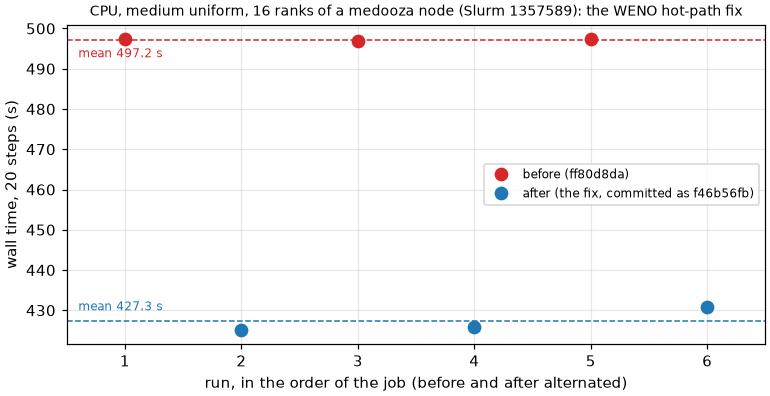
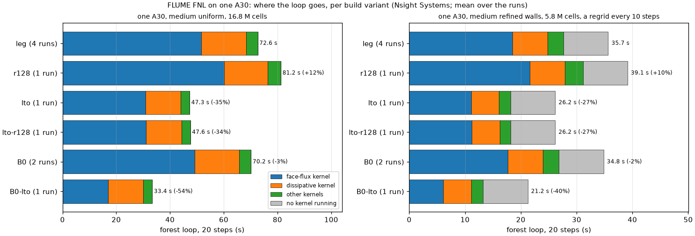
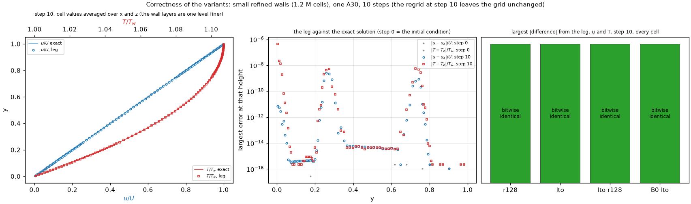
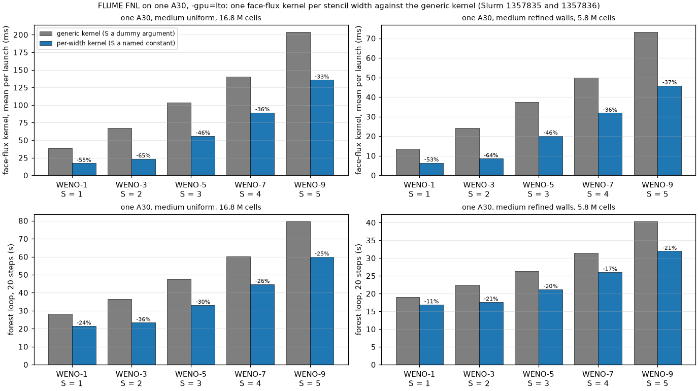
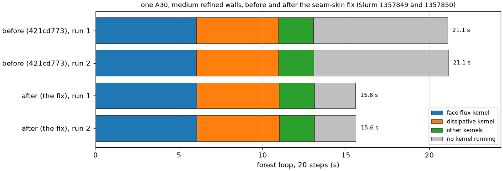

# profile-couette3d

A case for **profiling** FLUME and the ADAM library, not for speedup measurements or verification: one short,
steady, reproducible run that goes through the main regions of the code, on WSL, on medooza and on the AMD node. It is
outside the speedup matrix (`../run.sh` and `../analyze.sh` ignore it) and shares only its executables: the builds
of FLUME that `../build.sh` makes, one per backend and compiler, called legs (`cpu`, `fnl-nvf`, `fnl-amd`; see
[Run](#run)).

## The flow

The exact compressible Couette flow of `regression/couette` (issue #65, VV-3), extended to 3-D: an isothermal no-slip
wall at y = 0 (T = 1), a no-slip adiabatic wall moving at u = 1 at y = 1, periodic in x and z; γ = 1.4, μ = 0.01,
Pr = 0.75. The initial condition is the exact steady solution, so the flow does not evolve: every profile of a given
size sees the same work, whatever the step.

## What a profile goes through

| Region | Where | How the case exercises it |
|---|---|---|
| Convective residual | WENO-5 flux splitting on characteristic variables (`compute_residuals_weno`, FLUME cpu/fnl objects and Euler kernels) | x, y and z (3-D octree, nothing null) |
| Dissipative residual | viscous stress and heat flux, 4th order (`adam_flume_dissipation_library`, cpu/fnl dissipation kernels) | μ = 0.01: the viscous time step bound is of the order of the convective one |
| Time integration | SSP Runge–Kutta 5 stages (`adam_rk_object`, FNL `rk_fnl`) | stage buffers, a ghost exchange per stage |
| Boundary conditions | `adam_flume_bc_object`, `set_boundary_conditions` | isothermal and moving no-slip walls, periodic x and z, edges and corners |
| Ghost exchange | `update_ghost` (local copies and MPI, GPU-direct on FNL) | every stage, across ranks when np > 1 |
| AMR seams and reflux | 2:1 seam ghost fill (restriction, prolongation), the forest flux register (`adam_forest_object`) | the block layer along each wall is one level finer (two box markers): 2:1 seams parallel to the walls, reflux every step |
| Runtime regrid | `regrid_forest` (marking, ghost refresh, the library regrid; FNL: the host round trip) | every 10 steps; the box markers vote "keep", so the grid does not change |
| Reductions | the global time step, the conservation integrals | every step |
| Output (optional) | HDF5 checkpoint (`save_xh5f`) | `--io`: the first and last step |

**Not exercised:** the immersed boundary (distance function, eikonal extrapolation, wall inversion), the prolongation
of a regrid that changes the grid, inter-realm (multi-realm) seams (but see the two-realm variant below), MHD, gravity,
the positivity limiter. Profile
those on the speedup cases (`../xyz-shock-sphere-amr`, for example, has the immersed boundary and real regrids).

## Three variants

- **Refined walls** (default): everything in the table above.
- **Uniform** (`--uniform`): the simplest run, one realm on a uniform grid with no AMR marker, no regrid and no 2:1
  seam. It keeps the convective and dissipative residuals, the stages, the boundaries, the ghost exchange and the
  reductions, so its profile is the solver alone; set against the refined-walls profile of a similar size, the
  difference prices the AMR machinery (seam fills, reflux, regrids).
- **Two realms** (`--realms 2`, [#110](https://github.com/szaghi/adam/issues/110) P6): the refined walls as a forest of
  two realms, the channel split at x = 0.5 (each realm NI/2 cells along x, so the cells are those of one realm), x
  extrapolated outside (the Couette flow does not vary along x, so it stays steady; a seam cannot wrap the periodic x
  axis), one `coupling = auto`, `stage_coincident` seam across both refined wall layers. The seam has mixed levels:
  equal cells face by face, finer along the walls. Set against the refined walls of the same size it is not a clean
  price of the seam: the forest also has twice the blocks, each half as thick along x (a larger ghost share), and
  extrapolated x faces in place of periodic ones. The seam's own cost is in its timing lines
  (`forest seam timing`). The box markers keep the grid, so a regrid never rebuilds
  the inter-realm topology; `--rebuild` rebuilds it after every step (`ADAM_FOREST_REBUILD_TOPOLOGY=1`), which prices
  the rebuild a regrid that changes the grid pays. With `ADAM_SEAM_TIMING=1` (always on in `profile.sh`) the log
  times the regrid, the cross-realm balance, the topology rebuilds and the seam refills
  (`forest regrid timing`), the phases of a rebuild (`forest rebuild phases`: coupling checks, flux register, seam ghost
  rows and boundary crown, backend hook), next to the seam fill phases (`forest seam timing`). The candidates these
  timers should rank are listed, by code reading, in issue #110 P6 (night notes of 2026-10-29).

| Uniform size | Grid | Cells | Memory (estimate) | For |
|---|---|---|---|---|
| `small` | NI 16, level 3: 512 blocks | 2.1 M | ~2.8 GB | WSL (CPU np 2, one GPU) |
| `medium` | NI 32, level 3: 512 blocks | 16.8 M | ~15 GB | one A30, the medooza CPU node |
| `large` | NI 32, level 4: 4096 blocks | 134 M | ~117 GB | one AMD GPU (192 GB) |

## Sizes of the refined-walls variant

| Size | Blocks | Cells | Memory (estimate) | For |
|---|---|---|---|---|
| `small` | NI 16, base level 2, walls level 3: 288 | 1.2 M | ~1.6 GB | WSL (CPU np 2, one GPU), one A30 |
| `medium` | NI 16, base level 3, walls level 4: 1408 | 5.8 M | ~8 GB | the medooza CPU node (np 64), one or four A30 |
| `large` | NI 32, base level 3, walls level 4: 1408 | 46 M | ~40 GB | one AMD GPU (192 GB); four A30 (~10 GB each) |

The size matters on a GPU: a case that is small for the device leaves it waiting on kernel launches, and its profile
then shows launch latency rather than kernel cost. Profile the kernels on a size that loads the GPU (`medium` on an
A30, `large` on an AMD GPU); `small` on a big GPU is a profile of the launch overhead. The committed
`input-<size>.ini` and `input-<size>-uniform.ini` are what `profile.sh` writes (20 steps, a regrid every 10 on the
refined-walls variant, no output).

Wall times of the 20 steps, start-up included, measured on medooza (commit `f46b56fb`): `medium` on one A30, 50 s
refined walls and 89 s uniform under Nsight Systems; `medium` uniform on 16 ranks of a CPU node, 427 s without a
profiler. On WSL `small` takes a few minutes on 2 CPU ranks and tens of seconds on one GPU (a planning figure: WSL is
not a benchmark machine). `large` has not been run yet. Profilers add their own overhead: Nsight Systems and rocprofv3
tens of percent; Nsight Compute replays each profiled kernel many times, so `profile.sh` limits it to 300 kernels of
rank 0.

## Run

### Legs: which build of FLUME runs

A **leg** is one build of FLUME for one backend and compiler, named by a short word. The speedup matrix (`..`) and
this profiling case use the same three legs. The leg is the first argument of both scripts: `../build.sh <leg>` builds
it and keeps its executable in `../exe/<leg>/`, and `./profile.sh <leg>` runs that executable.

| Leg | What runs | fobis mode | Machines | Executable |
|---|---|---|---|---|
| `cpu` | CPU only, MPI ranks (gfortran + Open MPI) | `flume-cpu-gnu` | WSL, medooza CPU nodes | `../exe/cpu/adam_flume_cpu` |
| `fnl-nvf` | NVIDIA GPUs, OpenACC (nvfortran), one MPI rank per GPU | `flume-fnl-nvf` | WSL (RTX 4070), medooza (A30) | `../exe/fnl-nvf/adam_flume_fnl` |
| `fnl-amd` | AMD GPUs, OpenMP offload (amdflang), one MPI rank per GPU | `flume-fnl-omp-amd` | the AMD node | `../exe/fnl-amd/adam_flume_fnl` |

`build.sh` also needs the **varset** of the machine (`--varset`, the HDF5 build and the GPU target of the repository
`fobos`): `local_gnu` / `local_nvf` on WSL, `iac_gnu` / `iac_nvf` on medooza, `"thera_amd gfx942"` on the AMD node. A
**variant** (`--tag NAME`, [below](#build-variants)) is a second build of the same leg with other flags or sources.

### Step by step

Every recipe starts at the repository root. A build cleans its mode first and takes minutes (`fnl-nvf` with LTO about
14 min on 16 cores); a profile of `small` takes seconds on a GPU and minutes on 2 CPU ranks.

**WSL, `cpu` leg** (2 ranks; Nsight Systems samples the CPU, perf is not installed):

```bash
module load gcc/16.2.0 openmpi/5.0.11-gnu16.2.0
export PATH=$PATH:/opt/nvidia/hpc_sdk/Linux_x86_64/26.9/compilers/bin   # nsys, after the gnu mpirun
cd src/tests/flume/speedup
./build.sh cpu --varset local_gnu --jobs 8           # -> exe/cpu/adam_flume_cpu and builds/cpu/toolchain.md
cd profile-couette3d
./profile.sh cpu --size small --np 2 --tool nsys     # -> runs/cpu-small-np2-nsys/
nsys stats runs/cpu-small-np2-nsys/nsys-r0.nsys-rep  # MPI and OS-runtime summaries only
```

The CPU hot spots (the samples) are not in `nsys stats`: open `runs/cpu-small-np2-nsys/nsys-r0.nsys-rep` in the Nsight
Systems GUI (Bottom-Up view), or export it (`nsys export --type sqlite`) and query its sample tables.

**WSL, `fnl-nvf` leg** (one rank on the second GPU: the first drives the display and Windows silently pages the
device memory of a run that fills it, which makes kernels 4-10 times slower; the `nvhpc` module sets the UCX
workarounds of issue #12):

```bash
module load nvhpc/26.9
cd src/tests/flume/speedup
./build.sh fnl-nvf --varset local_nvf --jobs 8       # -> exe/fnl-nvf/adam_flume_fnl
cd profile-couette3d
export CUDA_VISIBLE_DEVICES=1
./profile.sh fnl-nvf --size small --np 1 --tool nsys --launcher "mpirun -x ADAM_SEAM_TIMING -x CUDA_VISIBLE_DEVICES -np"
nsys stats --report cuda_gpu_kern_sum runs/fnl-nvf-small-np1-nsys/nsys-r0.nsys-rep   # time per kernel
```

Nsight Compute on WSL (`--tool ncu`) needs the GPU performance counters enabled in the Windows NVIDIA Control Panel
(`ERR_NVGPUCTRPERM` otherwise); compute-sanitizer is blind there. WSL times are for planning, not benchmarks.

**medooza, `fnl-nvf` leg, one A30** (build on the login node: `iac_nvf` pins CUDA 12.9, which the A30 nodes run; then
an allocation on `dev-gn`, whose limit is one hour; `srun` forwards the environment):

```bash
source /ifs/hpc/home/szaghi/nvidia/nvhpc.sh
cd ~/adam/src/tests/flume/speedup
./build.sh fnl-nvf --varset iac_nvf --jobs 16
salloc -A iacroma -p dev-gn -N 1 --gres=gpu:4 --ntasks-per-node=4 --mem=96G --exclusive -t 00:59:00
cd profile-couette3d
./profile.sh fnl-nvf --size medium --np 1 --tool nsys --launcher "srun --mpi=pmix -n"            # refined walls
./profile.sh fnl-nvf --size medium --uniform --np 1 --tool nsys --launcher "srun --mpi=pmix -n"  # uniform
./profile.sh fnl-nvf --size large --np 4 --tool nsys --launcher "srun --mpi=pmix -n"             # the 4 A30
```

The same as a batch job (`sbatch profile-a30.slurm`, run from `profile-couette3d/` after the build):

```bash
#!/bin/bash
#SBATCH -A iacroma
#SBATCH -p dev-gn
#SBATCH -N 1
#SBATCH --ntasks-per-node=1
#SBATCH --gres=gpu:4
#SBATCH --mem=96G
#SBATCH --exclusive
#SBATCH -t 00:59:00
source /ifs/hpc/home/szaghi/nvidia/nvhpc.sh
./profile.sh fnl-nvf --size medium --np 1 --tool nsys --launcher "srun --mpi=pmix -n"
```

**medooza, `cpu` leg** (16 ranks of a node, as in the results below; `gnu.sh` already turns hcoll off, which crashes
in `MPI_Finalize` there):

```bash
source /ifs/hpc/home/szaghi/gnu/gnu.sh
cd ~/adam/src/tests/flume/speedup
./build.sh cpu --varset iac_gnu --jobs 16
salloc -A iacroma -p prod-gn -N 1 --ntasks=16 --mem=64G -t 01:00:00
cd profile-couette3d
./profile.sh cpu --size medium --uniform --np 16 --tool none --launcher "srun --mpi=pmix --cpu-bind=cores -n"
```

**AMD node, `fnl-amd` leg** (one rank per GPU; rocprofv3 from ROCm 6.2 or later):

```bash
cd src/tests/flume/speedup
./build.sh fnl-amd --varset "thera_amd gfx942" --jobs 16
cd profile-couette3d
./profile.sh fnl-amd --size large --np 1 --tool rocprof   # per-kernel statistics in runs/fnl-amd-large-np1-rocprof/
./profile.sh fnl-amd --size large --np 8 --tool rocprof   # the same split over the node: communication shows up
```

### What a run writes

```bash
./profile.sh <leg> --size <small|medium|large> [--uniform] --np <N> --tool <none|nsys|ncu|rocprof|perf> [--steps N] [--io]
             [--scheme weno-u-<2S-1>] [--tag NAME] [--exe PATH] [--launcher "CMD"] [--dry-run]
```

Every run goes to `runs/<leg>-<size>[-uniform][-<scheme>]-np<N>-<tool>[-<tag>]/` (a previous one is renamed, not
overwritten; the scheme is in the name only when it is not the default `weno-u-5`). `--scheme` sets the WENO scheme of
the input, `weno-u-1` to `weno-u-9` (half-width S = 1 to 5), and the ghost cells with it, `ngc = max(3, S)`: WENO-7 and
WENO-9 runs have wider blocks in memory, so their loops do not price the stencil alone. The run writes `input.ini`,
`log.txt`, `wall.txt`, `run.info` (host, job, scheme, command, executable and its digest, commit, `src_modified`) and
the profiler files, one per rank. `ADAM_SEAM_TIMING=1` is always set, so the end of `log.txt` carries the forest timing
report (loop, steps, reflux, seam fills; max over the ranks), which `profile.sh` prints. `--dry-run` prints the command
without running it. The default launcher is `mpirun -x ADAM_SEAM_TIMING -np`; give `--launcher` when another variable
must reach the ranks (Open MPI forwards only the ones `-x` names) or under Slurm (`srun` forwards all).

### Tool limits on medooza

Two tools do not run on medooza (October 2026): **Nsight Compute** stops with `ERR_NVGPUCTRPERM` (no permission to
access the GPU performance counters: the driver reserves them to the administrators, presumably through its
`NVreg_RestrictProfilingToAdminUsers` option), and **perf** is not installed (`which perf` finds nothing on the login
node nor on a compute node). Without counters, the registers and the stack (local memory) of every kernel are in the
executable (`cuobjdump --dump-resource-usage <exe>`) and in the Nsight Systems trace (`nsys stats --report
cuda_gpu_trace`, column `Reg/Trd`); for the counters themselves use Nsight Compute on WSL (second GPU), keeping in mind
that its consumer GPU runs FP64 at 1/64 of the FP32 rate, so its kernels are bound by FP64 throughput where an A30 is
not.

### Build variants

A profiling experiment that changes how the code is compiled builds a **variant** of a leg, so that the leg's
executable and toolchain record stay as they are and the two can be profiled side by side:

```bash
cd .. && ./build.sh fnl-nvf --varset iac_nvf --jobs 16 --tag r128 --gpu maxregcount:128   # -> exe/fnl-nvf-r128/
cd profile-couette3d
./profile.sh fnl-nvf --size medium --np 1 --tool nsys --tag r128 --launcher "srun --mpi=pmix -n"
```

`--gpu OPTS` (the `fnl-nvf` leg only, with `--tag` and a clean build) appends `-gpu=OPTS` to the compile and link flags
of the fobis mode: fobis appends `--cflags`/`--lflags` to the mode's own, and nvfortran merges the two `-gpu=` options.
The fobos files and the default build do not change; removing the variant is `rm -r ../exe/fnl-nvf-<tag>
../builds/fnl-nvf-<tag>`. A variant's `toolchain.md` records the full compile and link flags and is not embedded in the
speedup case READMEs. A source experiment (a patch) is built the same way, from a tree with the patch applied:
`toolchain.md` then marks the commit `src/ modified`.

Since the `lto` result below, the varsets `local_nvf` and `iac_nvf` build every optimized OpenACC mode with
`-gpu=...,lto` (the fobos variable `$NVF_LTO`): the `fnl-nvf` leg is now what the variant `lto` was, and `--gpu lto`
adds nothing there. The leg of the results below, without LTO, is `--varset "iac_nvf nolto"`.

**On the `fnl-amd` leg** a *source* variant needs nothing new — `--tag` is not leg-restricted, and
`patches/face-kernel-s3.patch` touches `src/app/flume/fnl/adam_flume_fnl_face_kernels_agnostic.INC`, which every FNL
backend compiles:

```bash
git apply src/tests/flume/speedup/profile-couette3d/patches/face-kernel-s3.patch   # from the repository root
cd src/tests/flume/speedup && ./build.sh fnl-amd --varset "thera_amd gfx942" --jobs 32 --tag B0
git -C ../../.. apply -R src/tests/flume/speedup/profile-couette3d/patches/face-kernel-s3.patch
```

A *compiler-flag* variant has no AMD form yet: `--gpu` prepends nvfortran's `-gpu=` umbrella and stays
`fnl-nvf`-only, and amdflang's knobs are plain flags with no umbrella to prepend. **There is deliberately no `lto`
variant on AMD: device LTO is already the default there.** A driver dry-run with no LTO flag at all already shows the
device job as `-emit-llvm-bc` and the link going through `clang-linker-wrapper` with `--device-compiler=` /
`--device-linker=`, i.e. the device link is already a full-LTO link over every translation unit's bitcode —
`-foffload-lto` and `--offload-lto` are rejected because there is nothing to enable, and plain `-flto` only adds host
LTO plus a redundant `-flto=full` to a device compile that was already emitting bitcode. There is likewise no
`maxregcount` analogue: `amdgpu-waves-per-eu` is a function attribute, not a driver flag. The occupancy lever that
costs no rebuild is `OMP_NUM_TEAMS` / `OMP_TEAMS_THREAD_LIMIT`, because FUNDAL's `OMPLOOP`
(`src/third_party/FUNDAL/src/lib/fundal.H`) emits a bare `target teams distribute parallel do` with neither clause —
pass them through with `--launcher "mpirun -x ADAM_SEAM_TIMING -x OMP_NUM_TEAMS -x OMP_TEAMS_THREAD_LIMIT -np"`,
since the default launcher forwards only the variables it names.

**AMD node** (one rank per GPU; `mpirun` is the default launcher and needs no `--launcher` there):

```bash
export PATH=/opt/rocm-7.2.1/bin:$PATH                     # see the rocprofv3 note below -- not optional on thera
./profile.sh fnl-amd --size large            --np 1 --tool rocprof   # per-kernel statistics in runs/.../rocprof-r0/
./profile.sh fnl-amd --size large --uniform  --np 1 --tool rocprof
./profile.sh fnl-amd --size large            --np 8 --tool rocprof   # over the node: communication shows up
./profile.sh fnl-amd --size large --uniform  --np 8 --tool rocprof
```

**Which `rocprofv3`.** `profile.sh` calls it by name, so PATH decides, and on thera the first one on PATH is the
rocprofv3 **1.2.3** bundled with the therock compiler drop — which **aborts this executable** under `--kernel-trace`:
the run dies mid-step with `OFFLOAD ERROR: memory access fault by GPU N ... at virtual address (nil)`, then
`rocprofv3 caught signal 6`. It is specific to kernel-dispatch interception on this binary: the same build runs to
completion with `--tool none`, with `AMD_SERIALIZE_KERNEL=3`, and under the same rocprofv3 with `--hip-trace` only,
and rocprofv3 1.2.3 traces a minimal amdflang offload program fine. The rocprofv3 **1.1.0** of `/opt/rocm-7.2.1`
traces it correctly, so prepend that directory. Only the profiler changes: the application's own HIP, HSA and OpenMP
runtimes come from the compiler drop through the executable's RPATH either way.

## Reading the results

- `nsys stats <file>.nsys-rep` (or the Nsight Systems GUI): the kernel and memory-copy summaries, the OpenACC and
  MPI ranges; the timeline shows where the steps wait.
- `ncu-r0.ncu-rep` (Nsight Compute GUI or `ncu --import ... --page details`): occupancy, memory throughput, registers
  and spills of each kernel.
- `rocprof-r<N>/<host>/<pid>_*.csv`: `_kernel_stats.csv` ranks the kernels by total time and `_kernel_trace.csv`
  holds every dispatch — including, per kernel, `VGPR_Count`, `Accum_VGPR_Count`, `SGPR_Count`, `Scratch_Size` and
  `LDS_Block_Size`, so on AMD the registers and the scratch come with the trace where on NVIDIA they need a separate
  `cuobjdump --dump-resource-usage` run. `make_figures.py collect` records the three that vary between kernels here
  (VGPR, AGPR, scratch; SGPR is 112 and LDS 2048 for every offload kernel of this app). `_memory_copy_stats.csv` has
  the device-to-device copies, which are **not** in the figures' stack: they overlap kernels, so adding them as a
  segment would double-count.
- `perf report -i perf-r<N>.data`: the CPU hot spots with their call graphs.
- `./make_figures.py idle runs/<run>/` (an nsys run): where the GPU is idle inside the loop, by gap length, by the GPU
  operation that ends each gap, and the CPU samples that fall in the gaps; see
  [Time with no kernel running](#time-with-no-kernel-running).
- The forest timing line: the wall time of the loop and of the steps; their difference is the regrid and post-step
  share, the reflux and seam entries price the AMR machinery.

## Results

Measured in October 2026 at commit `f46b56fb` (nvfortran 26.9 with CUDA 12.9, gfortran 16.2 with Open MPI 5.0.11). The
GPU numbers come from one A30 of medooza (`gnode01`, driver 575, 1440 MHz), one rank, the `medium` size, 20 steps, under
Nsight Systems; kernel times are the mean per launch of `nsys stats --report cuda_gpu_kern_sum`, and the loop is the
forest timing line (the steps plus the regrids, without start-up). Repeated runs of the same executable, in three jobs,
agree to 0.6% in loop time and kernel means; the wall time, start-up included, varies by up to 8%.

### Where the time goes

**FNL, A30, the `fnl-nvf` leg as built at `f46b56fb` (before LTO became the default; called "leg" or "base" below):**

| | Refined walls | Uniform |
|---|---|---|
| `compute_face_fluxes_dev` (WENO-5 convective fluxes, one direction per launch) | 61.6 ms, 67% of the GPU time | 172.4 ms, 71% |
| `add_dissipative_fluxes_o4_dev` (viscous fluxes) | 21.0 ms, 23% | 55.3 ms, 23% |
| every other kernel | 10% | 6% |
| GPU busy (kernel time / loop) | 27.7 s / 35.6 s = 78% | 72.7 s / 72.6 s = 100% |

The two flux kernels are the whole cost of the uniform run. On the refined walls 8 s of the loop (22%) have no kernel
running (a lower bound: the kernel total includes the start-up kernels). At most 1.9 s of it is the regrid and
post-step share (loop minus steps); the other 6 s fall inside the steps. The 3708 launches of
`blend_inadmissible_ghosts_dev` (22 µs each on average, 82 ms in all) cannot fill them. Those 6 s were a host loop over
the AMR seam faces, once per Runge–Kutta stage, since cut from 59 ms to 3.6 ms per stage (see
[Time with no kernel running](#time-with-no-kernel-running)).

**CPU** (Nsight Systems sampling on WSL, 2 ranks; shares only, WSL is not a benchmark machine): the WENO weights 31%,
the dissipative fluxes about 20%, `malloc`/`free` 10.5% and the integer power `__powidf2` 2.9%, both inside the WENO
weights, the AMR machinery about 2%. The last two were avoidable: the locals of `adam_weno_object` had bounds depending
on `S`, so gfortran put them on the heap, and `(zeps + IS)**wexp` with a variable integer `wexp` called the integer
power of libgcc. Commit `f46b56fb` fixed both, bitwise (the products are formed in `__powidf2`'s order): `medium`
uniform on 16 ranks of a medooza CPU node went from 497 s to 427 s (three runs each, alternated; the "after" build
was the fix before its commit, so the run records carry the HEAD of the time, `ff80d8da`):



### The face-flux kernel on the A30

`cuobjdump --dump-resource-usage` gives `compute_face_fluxes_dev` 254 registers and a 3608-byte stack per thread: its
private arrays (`qs`, `qas`, `fsplit`, `er`, …, sized by `S_MAX = 5`) go to local memory, because their addresses are
passed to device routines of other modules (`face_split_fluxes`, the Roe average and eigenvectors, the WENO
reconstruction, the back-projection) that nvfortran compiles as calls (`-Minfo`: "Local memory used for qas, mu, flux,
fsplit, qs, vr_, vr, v, er"). Four variants were built (`../build.sh --tag`, see [Build variants](#build-variants);
Slurm job 1357634) and timed with the leg (built in job 1357614) in one job, 1357635:

| Variant | `-gpu=` added | Face kernel: registers, stack | Face kernel, uniform | Dissipative, uniform | Loop, uniform | Loop, refined |
|---|---|---|---|---|---|---|
| leg (base) | none | 254, 3608 B | 172.4 ms | 55.3 ms | 72.6 s | 35.6 s |
| `r128` | `maxregcount:128` | 128, 3704 B | 200.4 ms (+16%) | 53.9 ms | 81.2 s (+12%) | 39.1 s |
| `lto` | `lto` | 148, 2720 B | 103.1 ms (−40%) | 43.6 ms (−21%) | 47.3 s (−35%) | 26.2 s (−27%) |
| `lto-r128` | `lto,maxregcount:128` | 148, 2720 B | 103.6 ms | 44.2 ms | 47.6 s | 26.2 s |
| `B0-lto` | `lto`, and the patch below | 210, 2368 B | 56.3 ms (−67%) | 44.0 ms (−20%) | 33.4 s (−54%) | 21.2 s (−40%) |

and, from an earlier job (1357619), `B0` without LTO: 164.1 ms (−5%), loop 70.1 s uniform and 34.8 s refined. The figure
splits each loop into the two flux kernels, the other kernels and the time with no kernel running; its bars are the
means over every run of a variant (the leg ran four times in three jobs, `B0` twice), so they differ from the table,
which is job 1357635 alone, by at most 0.2%:



- **Link-time optimisation is the largest single gain.** With `-gpu=lto` the device link inlines the device routines
  across modules (a two-module test: one `CALL` in the SASS without it, none with it), which removes the calls and much
  of the local memory they forced. Both flux kernels gain (the face one 40%, the dissipative one 21%), and the other
  kernels together 24% (4.37 s to 3.31 s, uniform). The `fnl-nvf` build takes longer: about 830 s against 540 s without
  LTO, on 16 cores of a GPU node.
- **Occupancy is not the limit.** Capping the registers at 128 (`r128`) raises the theoretical occupancy from 2 to 4
  blocks of 128 threads per SM and makes the face kernel 16% slower: the spills it adds cost more than the warps it
  gains. Under LTO `maxregcount:128` is not honoured (`lto-r128`: 148 and 134 registers, both above the cap), so that
  variant tests no cap and the conclusion rests on `r128` alone.
- **A compile-time stencil width pays only with LTO.** `patches/face-kernel-s3.patch` (experiment B0) makes the
  half-width `S` a constant, `SC = 3`, in `compute_face_fluxes_dev`: alone it saves 5%, because the arrays are still
  passed to calls; with LTO the calls are inlined, the constant bounds presumably let the stencil loops unroll (not
  checked in the SASS), and the face kernel drops to a third of the leg's. The patch is **valid only for WENO-5 inputs**
  and was never committed; the code now does the same for every width, see
  [One face-flux kernel per stencil width](#one-face-flux-kernel-per-stencil-width).
- **The compiler's own inlining does not work here.** `-Minline` inlines only routines of the same file (cross-file
  inlining needs extracted libraries and still refuses `weno_reconstruct_upwind_dev`: "missing prototype during
  crossing files"). With the library bodies included into the kernel file and `-Minline=reshape` everything inlines, but
  the inlined routines' local arrays are left out of the kernel's `private` clause and become implicit copies and
  reductions (`Generating implicit reduction(+:..inline)`): the launch faults in `__pgi_uacc_dataup`. `-gpu=lto`
  inlines after the OpenACC lowering, and does not have this problem.
- **On the refined walls the time outside the kernels stays.** The loop minus the kernel time is 7.95 s for the leg
  and 8.04 s for `B0-lto`; as the kernels shrink from 27.7 s to 13.2 s, that share grows from 22% to 38% of the loop.
  Most of it was the host update of the AMR flux register, since cut (see
  [Time with no kernel running](#time-with-no-kernel-running)).

**Correctness of the variants.** Every variant but `B0` (timed only) ran `small`, refined walls, 10 steps with
checkpoints at steps 0 and 10 (`--steps 10 --io`); `h5diff` found every checkpoint bitwise identical to the leg's, and
so does the figure, cell by cell. The regrid at step 10 leaves the grid unchanged (the markers are geometric), so it
rebuilds the maps and moves no data: these runs do not check a regrid data transfer.



The initial condition is the exact solution at the cell centres (step 0: errors of round-off, 1e-16). After 10 steps u
and T follow the exact profiles; the error stays at round-off (1e-16 to 1e-14) inside each level and grows only where
the scheme is not exact for this solution: at the isothermal wall (4e-7 on T: its mirror ghost is second order, as in
VV-3) and on both sides of the two 2:1 seams, y = 0.25 and 0.75, where the wall layers meet the base level (up to 1e-8;
the seam ghosts are prolonged and restricted). This case is still a weak check of a build change: the solution is
steady, so 10 steps move it only by these amounts. It shows that the variants run and agree to the last bit here; it is
not a regression suite. A build change adopted from these results passes the FLUME and PRISM FNL regression suites
first.

**Nsight Compute on WSL** (the second GPU, `small` uniform, one launch of the face kernel) agrees on the cause and not
on the cost: the leg's kernel writes 5.75 GB to DRAM for 89 MB of fluxes (the rest is local memory) and executes 139 M
local loads and stores against 33 M global loads; `lto` cuts the local traffic by half and `B0-lto` by 83%, with 65%
fewer instructions. Its duration changes by less than 10%: the RTX 4070 runs FP64 at 1/64 of the FP32 rate, and the
full Nsight Compute set of the leg's kernel names FP64 as its busiest pipeline (83%); the A30 runs FP64 at 1/2 of the
FP32 rate.

### One face-flux kernel per stencil width

Experiment B0 made into code. The two flux-splitting face routines of the FNL backend, `compute_face_fluxes_dev` and
`add_gravity_edge_correction_dev` (`src/app/flume/fnl/adam_flume_fnl_face_kernels_agnostic.INC`), are host dispatchers:
one `select case (S)` calls the kernel compiled for that half-width, `compute_face_fluxes_s<N>_dev` with `S` a named
constant, N = 1 to 5 (WENO-1 to WENO-9; `S_MAX = 5`), and the `case default` calls the generic kernel
`compute_face_fluxes_sn_dev`, `S` a dummy argument, as before. No width FLUME accepts today reaches the generic kernel;
it is there for a width added later, which runs on it until it gets its own case. Every kernel includes the same body
(`adam_flume_fnl_face_fluxes_kernel_body.INC`, `adam_flume_fnl_gravity_edge_kernel_body.INC`) after its declaration of
`S`, so the kernel has one source. Nsight Systems now lists the face kernel under the name of its width
(`..._compute_face_fluxes_s3_dev_...` for WENO-5); `make_figures.py` sums every face kernel of a run. The Riemann face
kernels (`weno-riemann`) and the CPU backend are unchanged.

Measured at commit `dcdc49c1` with this change applied (`run.info`: `src_modified=yes`), the `fnl-nvf` leg as built by
default since that commit (with `-gpu=lto`), against the variant `generic`: the same tree with both dispatchers calling
the generic kernel for every width (`select case (-S)`, a temporary edit, reverted after the build). One A30, one rank,
`medium`, 20 steps, `--scheme weno-u-1 ... weno-u-9`; Slurm job 1357835 (the per-width kernels) and 1357836 (`generic`):

| WENO (S) | Face kernel, uniform: per-width / generic | Loop, uniform | Face kernel, refined walls | Loop, refined walls |
|---|---|---|---|---|
| 1 (1) | 17.3 / 38.4 ms (−55%) | 21.5 / 28.4 s (−24%) | 6.4 / 13.5 ms (−53%) | 16.9 / 19.1 s (−11%) |
| 3 (2) | 23.5 / 67.3 ms (−65%) | 23.4 / 36.6 s (−36%) | 8.6 / 24.1 ms (−64%) | 17.6 / 22.4 s (−21%) |
| 5 (3) | 56.0 / 103.4 ms (−46%) | 33.1 / 47.4 s (−30%) | 20.1 / 37.4 ms (−46%) | 21.2 / 26.4 s (−20%) |
| 7 (4) | 89.3 / 140.4 ms (−36%) | 44.7 / 60.1 s (−26%) | 31.9 / 49.8 ms (−36%) | 26.1 / 31.4 s (−17%) |
| 9 (5) | 135.8 / 203.6 ms (−33%) | 59.9 / 79.6 s (−25%) | 45.9 / 73.2 ms (−37%) | 32.0 / 40.3 s (−21%) |



- **Every width gains, so every width keeps its kernel.** Per launch the face kernel is 33% to 65% faster; the loop 11%
  to 36%. `cuobjdump --dump-resource-usage` of the leg gives the kernels of S = 4 and 5 255 registers (the most a
  thread can have) and 2.7 KB of stack, against 148 registers and 2.7 KB for the generic kernel: they presumably spill
  (not measured: Nsight Compute does not run on medooza), and still win by a third. S = 1, 2 and 3 use 156, 212 and
  210 registers.
- **WENO-5 reproduces B0.** 56.0 ms per launch against 56.3 ms for `B0-lto`, and the generic kernel's 103.4 ms against
  103.1 ms for `lto`: the generic path is the code before this change, built with LTO.
- **The refined walls gain less in the loop** (11% to 21%) for the reason given above: the time with no kernel
  running does not shrink with the kernels (these runs predate the seam-skin fix below).
- **The build is slower.** Five more face kernels and five more edge kernels per flux-splitting model: the `fnl-nvf`
  leg took 1006 s on 16 cores of a GPU node (job 1357834), against about 830 s before; on WSL 462 s against 377 s (a
  planning figure).

**Correctness.** On WSL (`small` refined walls, 10 steps with checkpoints, `ngc` 3 to 5; runs compared with `h5diff`
and not kept) the per-width kernels and the generic one give bitwise identical checkpoints for WENO-1, 3, 5, 7 and 9.
The FLUME FNL regression suite with the per-width build (job 1357845) passes 54 of 54, and 169 of its 172 outputs are
bitwise identical to the build before the change (`-gpu=lto`, commit `dcdc49c1`). The three others are `noh-de`
(dual-energy Noh, WENO-5): its O(1) values differ by about 4e-11 relative (the total energy at the last step,
2.19999999997 against 2.20000000006) and its near-zero conservation drifts change sign (-3.3e-12 against 5.1e-11). Job
1357846 settled the cause: the per-width build reproduces itself bitwise, and the generic variant reproduces the
build before the change bitwise, so the difference is the constant `S` changing the order of the floating-point
operations of the inlined code (round-off), not a non-deterministic run.

### Time with no kernel running

On the refined walls the GPU waits for the host for 8 s of the loop: 22% of the leg's 35.6 s, 38% of the 21.1 s with LTO
and the per-width kernels. `./make_figures.py idle` locates it in the Nsight Systems trace: it takes the time from the
first to the last face-flux kernel (the steps, without start-up; it ends before the last stage's flux difference and the
final regrid), marks the GPU idle where no kernel, copy or memset runs, and attributes each idle gap to the GPU
operation that ends it and to the CPU samples that fall in it.

**One host loop per stage.** At commit `421cd773` (job 1357849, refined walls, 20 steps) the GPU is idle for 6.99 s of
the 19.97 s window, and 5.86 s of it in 99 gaps of 59 ms each, one per Runge–Kutta stage (5 stages, 20 steps: the 100th
falls after the window), each ending at `compute_flux_difference_dev`. Only one call runs there:
`accumulate_seam_fluxes` packs the skins of the 640 seam faces (128 coarse, 512 fine) on the device in one launch,
copies them to the host in one transfer, and loops on the host over the faces (`accumulate_seam_skin`, shared with the
CPU backend), which add them to the AMR flux register; the GPU waits. The CPU samples of the trace have broken call
stacks (the builds keep no frame pointers); a second trace with `nsys profile --backtrace=dwarf` (job 1357848, 4 steps)
completes them: 24% of the samples in the gaps have `pghpf_reshape_i8` in their stack under `accumulate_seam_skin`, and
nearly half end in the C allocator (`malloc`, `free`, `malloc_consolidate`: 48%). The source is one line, `fine_face =
weight * reshape(skin, [nv, inner_n, outer_n])`, for each of the 512 fine faces: nvfortran runs that `reshape` of a
contiguous skin through its general array runtime (`pghpf_reshape_i8`, `__fort_copy_i8`, `__fort_genlist`, ...), which
allocates and frees on every call. A test program on WSL times it at 30 µs per face, against 0.4 µs for the same copy
written as a loop over the two tangential axes.

**The fix.** That loop replaces the `reshape` (`adam_flume_common_object.F90`, `accumulate_seam_skin`); it forms the
same products, and the FLUME CPU and FNL regression suites stay bitwise identical. Two runs each (jobs 1357849 and
1357850, one A30, `medium` refined walls, 20 steps):

| | Before (`421cd773`) | After (`421cd773` and the fix) |
|---|---|---|
| Host gap before `compute_flux_difference_dev` | 59.2 ms per stage, 5.86 s | 3.6 ms per stage, 0.36 s |
| GPU idle in the window (`idle`) | 6.99 s of 19.97 s | 1.50 s of 14.52 s |
| Kernel time | 13.05 s, 13.07 s | 13.09 s, 13.11 s |
| Forest loop | 21.09 s, 21.12 s | 15.57 s, 15.60 s (−26%) |
| Loop minus kernel time | 8.03 s, 8.05 s | 2.47 s, 2.49 s |



**What is left.** 1.5 s of idle in the window: 0.93 s in gaps of 10 ms or more, the host work of the regrid at step 10
(the CPU samples fall in `mpi_redistribute`, the ghost maps, `copy_blocks_transposed`); 0.37 s in gaps of 0.1 to 10 ms,
almost all the 99 remaining host updates of the flux register (3.6 ms each); 0.20 s in gaps shorter than 0.1 ms, most
of them ending at a copy or a memset of the reflux and the seam fill (in 20 steps, 8376 gaps end at a copy and 4308 at a
memset). Outside the window lie 1.09 s before and 1.04 s after: the last stage's gap and the final regrid (the
regrid at step 10 is the 0.93 s above; loop minus steps, 1.94 s, counts both regrids). Moving the flux register to the
device would remove about 0.36 s of host updates, 2% of the loop. The CPU backend runs the same routine;
its timing was not measured.

### Two realms: the cost of a topology rebuild

Measured 2026-10-29/30 on `gnode01`, four A30, one rank per GPU (`--np 4`), the `medium` size, 20 steps, no profiler,
the forest timing lines (max over the ranks); two runs of each executable agree to 1 % in loop and regrid time
([#110](https://github.com/szaghi/adam/issues/110) P6):

| variant | loop | steps | regrid | topology rebuild |
|---|---|---|---|---|
| one realm (refined walls) | 4.69 s | 4.12 s | 0.57 s | - |
| `--realms 2` (a mixed `auto` seam) | 4.95-5.00 s | 4.66-4.71 s | 0.29 s | none (the box markers keep the grid) |
| `--realms 2 --rebuild`, commit 8a1137a0 | 13.9 s | 4.89 s | 9.0 s | 8.66-8.77 s / 20 |

The second realm costs about 6 % of the loop. A rebuild cost 0.43 s, about two steps of the case; its phases
(`forest rebuild phases`) and the two changes of P6 that cut it:

| per 20 rebuilds | 8a1137a0 | Morton decodes in place | + peer-leaf reuse per seam ghost |
|---|---|---|---|
| topology rebuild | 8.66-8.77 s | 5.33-5.34 s | 2.70-2.71 s |
| seam rows and crown | 5.84-5.95 s | 3.24 s | 0.60-0.61 s |
| flux register | 1.34 s | 0.81 s | 0.80 s |
| coupling checks | 0.39 s | 0.22 s | 0.22 s |
| backend hook (FNL device copies of the maps) | 1.09 s | 1.08-1.09 s | 1.09 s |
| run wall | 24.4-25.0 s | 20.9 s | 18.3-18.4 s |

A rebuild now costs 0.135 s, 0.6 steps of the case; the backend hook is its largest phase. Both changes keep every
regression output bitwise.

### Reproducing the results

The measurements are `results/runs.csv` (NVIDIA) and `results/runs-amd.csv` (AMD), one row per run directory (variant,
size, Slurm job, date, commit, executable, wall time, forest loop and steps, the mean per launch of the two flux
kernels, the total kernel time, and on AMD the registers and the scratch of each flux kernel), and the figures are
drawn from them and from the checkpoints of the correctness runs:

```bash
./make_figures.py collect runs/            # runs/ here or a copy of the profiling machine's; -> results/runs.csv
./make_figures.py figures runs/            # -> figures/*.png (needs numpy, matplotlib, h5py)
./make_figures.py idle runs/<run>/         # the idle gaps of one nsys run (its nsys*.sqlite, exported if missing)
```

**One results file per profiling machine, on purpose.** `collect` rewrites the whole output file from the run
directories it can see, and `runs/` is gitignored — so a `collect` on the AMD node cannot see medooza's run
directories and would replace its 33 rows with its own. It refuses instead: if the existing output holds runs that
this `runs/` does not, it names them and writes nothing, and `--force` is the deliberate override. `figures` reads
both files (or whichever `--results` paths are given) and skips, with a message, any figure whose runs are absent —
so either machine can redraw without the other's data. A run that `profile.sh` superseded, kept as
`<dir>.old-<timestamp>`, is not collected: it still has a `run.info` and a `wall.txt`, and averaging a replaced
measurement into the same bar as its replacement would be silent.

On medooza, one A30 of a `dev-gn` node held exclusively, every run with `--launcher "srun --mpi=pmix -n"`:

- job 1357614: the leg built (`../build.sh fnl-nvf --varset iac_nvf`, before LTO became the default: today `--varset
  "iac_nvf nolto"`) and timed, `./profile.sh fnl-nvf --size medium [--uniform] --np 1 --tool nsys`;
- job 1357619: `B0` built from the patch (applied, built with `fobis build --mode flume-fnl-nvf --varset iac_nvf`, today
  `--varset "iac_nvf nolto"`, kept as `../exe/fnl-nvf-B0/`, reverted), then the leg and `B0` timed twice each,
  alternated (`--exe`; `--tag` did not exist yet);
- job 1357634: the variants built, `../build.sh fnl-nvf --varset iac_nvf --jobs 16 --tag T --gpu G` (today `--varset
  "iac_nvf nolto"`, else every variant is also built with LTO) for `lto`, `r128` (`maxregcount:128`), `lto-r128` and,
  with `patches/face-kernel-s3.patch` applied and then reverted, `B0-lto`;
- job 1357635: for the leg and each of the four, `./profile.sh fnl-nvf --size small --np 1 --steps 10 --io [--tag T]`
  (correctness, compared with `h5diff`) and the two timings above `[--tag T]`.

The per-width kernels: job 1357835 built the variant `generic` (`../build.sh fnl-nvf --varset iac_nvf --jobs 16 --tag
generic`, from the tree with the temporary `select case (-S)`, reverted after the build) and timed the leg, built by
job 1357834 from the same tree without the edit, `./profile.sh fnl-nvf --size medium [--uniform] --np 1 --tool nsys
--scheme weno-u-<1|3|5|7|9>`; job 1357836 timed `generic` the same way (`--tag generic`).

The idle time: job 1357848 profiled the leg at `421cd773` with DWARF call stacks (`nsys profile
--trace=cuda,openacc,osrt --sample=cpu --backtrace=dwarf`, `medium` refined walls, 4 steps; `profile.sh` has no option
for it); job 1357849 timed that leg twice (`./profile.sh fnl-nvf --size medium --np 1 --tool nsys --tag seam-before
--exe ../exe/fnl-nvf/adam_flume_fnl`, each run directory then renamed `-r1`, `-r2`), and job 1357850 built the leg with
the fix (`../build.sh fnl-nvf --varset iac_nvf --jobs 16`) and timed it twice the same way without `--tag`. The kernel
summaries of these runs and the sqlite exports were written afterwards on the login node (`nsys stats --report
cuda_gpu_kern_sum --format csv -o kern`, `nsys export --type sqlite`).

The CPU before/after runs (job 1357589) are `./profile.sh cpu --size medium --uniform --np 16 --tool none --exe
<exe>`, alternated, three each. The figures take the nsys runs of one rank and 20 steps (`FIG_NP`, `FIG_STEPS` in
`make_figures.py`) of the Slurm jobs of their experiment: the variants figure averages the WENO-5 runs of jobs 1357614,
1357619 and 1357635 (`VARIANT_JOBS`) and warns when a bar mixes commits, the widths figure takes jobs 1357835 and
1357836 (`WIDTH_JOBS`), the seam figure jobs 1357849 and 1357850 (`SEAM_JOBS`), the CPU figure job 1357589.
