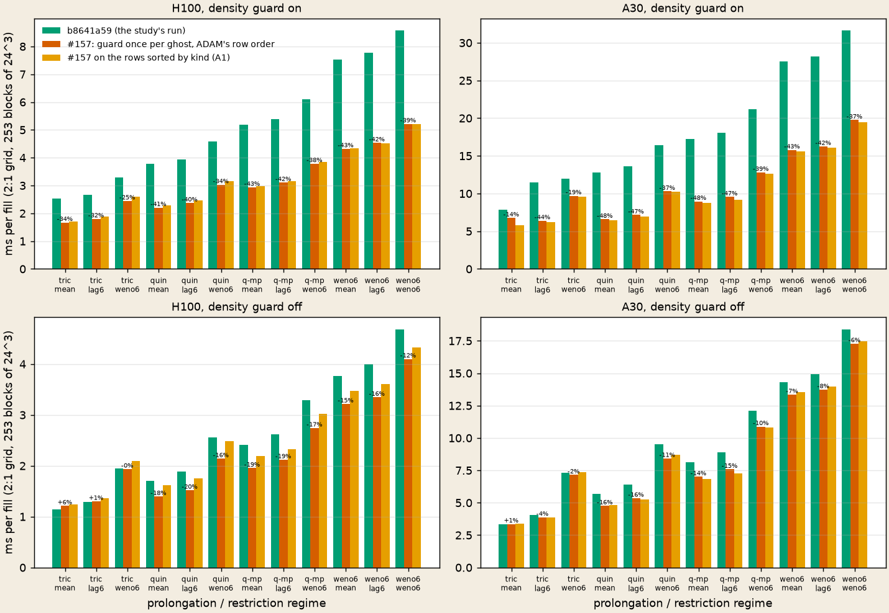

# AMR ghost-fill benchmark (2:1 neighbourhoods)

**Question** (2026-11-25): the uniform benchmark (`../README.md`) showed ADAM's local ghost fill moves its data at
10-16 % of a GPU's copy rate, the per-cell index map being the cost. On the frozen AMR sphere of #133 the same kernel
costs 5.6 times more per launch than on a uniform grid of the same row count (`speedup/README.md`, "Where the AMR
overhead goes": 14.6 against 2.6 ms on an A30), and how that split among the interpolation arithmetic, the branch
divergence and the donor reads was not measured. What does a 2:1 row cost, why, and what would a redesign gain?

`test_amr_ghost_bench.F90` (FoBiS mode `test-amr-ghost-bench-fnl-nvf`, linked to ADAM) builds a real 2:1 grid with
ADAM's own tree, grid and maps objects: the unit cube, an octree of blocks of b^3 cells (5 variables, `ngc` 3), refined
uniformly to a base level, then one more level on the blocks inside the box [0,s]^3: 2:1 faces, edges and corners
around the box. The FLUME density guard of the seam fill (#101) is on, the field smooth and positive, the seam regimes
those of `[amr] seam_ghost_fill` and `seam_restriction`, every high-order one included.

ADAM describes the ghost fill with a table, `maps%local_map_ghost(f, 1:13)`, one descriptor per (receiver block, donor
block, region): ranges, index shifts and the refinement relation (same level, finer donor: restriction, coarser
donor: prolongation). It expands the table into `maps%local_map_ghost_cell`, one row per ghost cell with its seam
metadata, deduplicated so that the last descriptor covering a ghost wins (#22 F1); only the rows reach the GPU, where
`update_ghost_local_gpu_dev` runs every kind of row in one launch, a branch per row.

| Variant | Kernel | Isolates |
|---|---|---|
| V0 | `update_ghost_local_gpu_dev` on ADAM's rows | today |
| V0s | the same kernel on the rows split by kind (copy / restriction / prolongation), one launch each | branch divergence; the per-kind costs |
| D1 | one kernel per kind over the descriptors: work items decoded from the ranges, the seam metadata computed on the device by ADAM's pure routines, the values by ADAM's operators (`interp_seam_ghost_gpu_dev`, `restrict_seam_high_order_gpu_dev`, the mean) | the per-cell map, on AMR |
| D2 | D1 batched in shape classes (same kind, ranges, shifts), the member blocks innermost | D1 with the uniform benchmark's coalescing |
| V0ng | V0 with the density guard off | the guard's cost; the reference of D3 |
| D3 | prolongation per coarse anchor (tricubic, guard off): the union of its 8 children's 4^3 footprints gathered once, each child interpolated by ADAM's `seam_interpolate_tricubic` on its slice | the reads the children of an anchor share |
| V0p | since #157: the kernel of b8641a59 (a verbatim copy of its `interp_seam_ghost_gpu_dev` in the harness: the guard recomputed per variable) on the same rows | the before of #157 in the same run, and its bitwise check |
| V0png | since #157: V0p with the guard off | the b8641a59 guard-off fill in the same run |
| V0k, V0kng | since #157: ADAM's kernel on a copy of the rows sorted by kind (copy, restriction, prolongation), guard on and off | #157 A1, rows grouped by kind |
| Ka, Kb, Kd, Kp | since #157 C: the copy rows alone as int32 donor/receiver offsets in one variable plane (Ka ADAM's order; Kb sorted by receiver, the receiving block fastest; Kd by donor), or packed as [block, ijk] pairs sorted as Kb on the 5-D field (Kp); checked against K0 (ADAM's kernel on the copy rows) | what the copies cost: the index bytes or the order |
| Ca-Cj | since #157 C: every row over compact rows in one launch (Ca ADAM's order, Cb by receiver, Cc by kind, Ce/Cf/Cg the heavy rows first or last, kept in ADAM's order in Cf/Cg), Ch the harness's heavy kernel then Kb, Ci/Cj ADAM's kernel on the heavy rows then Kb/Kp | the C4 design (Cj) |
| P1, P2, V0b | since #157 C4: the production fill's two launches timed apart (heavy rows, copy rows) and V0 timed again at the end of the run | the C4 fill, warm |

Overlapping descriptors: an owner mask (one int32 per stored cell of every block, from the descriptor order) gives each
ghost its winning descriptor; D1, D2 and D3 write a ghost only from its owner, ADAM's last-writer rule. **Every variant
is checked bit for bit after its timing: V0s, D1 and D2 against V0, D3 against V0ng's prolongation; every run, every
regime pair, both GPUs: identical.**

## Runs (2026-11-25)

`run.sh <varset> <out>` builds the mode and runs the matrix on one GPU (median of 30 fills, 20 at base level 3):

1. the **production-like grid**: blocks of 24^3, base level 2, box 0.75: 253 blocks (levels 2-3), 3.5 M cells, 2.87 M
   rows (88.1 % copy, 2.3 % restriction, 9.7 % prolongation), the row count per GPU of the frozen sphere 2c on 4 A30
   (254 blocks of 24^3, 2.86 M rows); every prolongation (tricubic, quintic, quintic-mp, weno6) x restriction (mean,
   lagrange6, weno6) pair;
2. the refined fraction: box 0.25 and 0.5 (4.2 % and 9.7 % prolongation rows);
3. the block edge: 16 and 32 at box 0.5;
4. a larger load: base level 3, box 0.5 (960 blocks, 13 M cells; `fields` 40 so the capacity holds the block indices).

Jobs: ESA SpaceHPC, one NVIDIA H100 (nvfortran 26.3, `spacehpc_nvf`): 184161 (V0, V0s, D1, D2), 184174 (with V0ng,
D3), 184175 (the larger load); medooza, one NVIDIA A30 (nvfortran 26.9, `iac_nvf`): 1369803, 1369806, 1369807 (the larger load). Results in
`results/`, figures by `plot.py` (in the docs page, below).

**Repeatability.** Every case ran twice per GPU (the two passes). On the H100 every time reproduces within 0.1 %. On
the A30, V0s reproduces within 4.2 % and V0 within 0.3 % in 15 of 20 cases; in 5 cases one pass of V0 ran 3-34 %
slower (tricubic / mean 7.83 and 10.45 ms, the first case of its job; 32^3 tricubic 5.86 and 7.86 ms): the
figures take the lower V0 of the two passes, the divergence figures below quote only cases stable in both.

## Results (H100, the reference)

**The fill on the production-like grid** (ms; V0s's launches by kind):

| Prolongation / restriction | V0 today | copy (88 % of rows) | restriction (2.3 %) | prolongation (9.7 %) | V0ng, guard off (its prolongation) |
|---|---|---|---|---|---|
| tricubic / mean (the defaults) | 2.54 | 0.92 | 0.10 | 1.38 | 1.15 (0.23) |
| tricubic / lagrange6 | 2.67 | 0.92 | 0.32 | 1.37 | 1.29 (0.24) |
| quintic / lagrange6 | 3.94 | 0.92 | 0.32 | 2.63 | 1.89 (0.88) |
| quintic-mp / mean | 5.18 | 0.92 | 0.10 | 4.12 | 2.42 (1.52) |
| weno6 / mean | 7.53 | 0.92 | 0.10 | 6.38 | 3.77 (2.84) |
| weno6 / weno6 | 8.57 | 0.92 | 1.02 | 6.38 | 4.68 (2.84) |

**The cost of one row** (all 5 variables, guard on): copy **0.36 ns**; restriction mean 1.5, lagrange6 4.9, weno6
15.5 ns; prolongation tricubic **5.0**, quintic 9.5, quintic-mp 14.9, weno6 **23.0 ns**. A prolongation row costs 14 to
64 copy rows.

- **The 2:1 cost is the prolongation arithmetic.** Under 10 % of the rows, the prolongation takes 54 % (tricubic) to
  85 % (weno6) of the fill; a weno6 restriction costs 1.0 ms, as much as all the copies. The copies cost what they cost on a
  uniform grid.
- **The density guard is most of it.** Without the guard the tricubic prolongation takes 0.23 ms instead of 1.38 (the
  guard is 83 % of it), the quintic 0.88 instead of 2.63, the weno6 2.84 instead of 6.38; the whole fill 45-59 % of its
  guarded time. The guard re-interpolates the density for each of the other four variables and re-gathers its
  footprint, per fine ghost: the same density work 5 times.
- **Branch divergence is minor on the H100**: splitting the rows by kind (V0s) changes the fill by -10 % to +7 %. On the
  A30 it gains up to 38 % (tricubic / lagrange6 11.5 -> 7.9 ms; 16^3 quintic / lagrange6 4.44 -> 2.74 ms).
- **The descriptor kernels do not transfer the uniform gain to AMR.** D2 makes the copies 18 % faster (0.75 against
  0.92 ms), far from the uniform benchmark's 3.8x: AMR descriptors are many, small and irregular (5,310 here, 154 shape
  classes), and the owner mask and the search are paid per cell. On the prolongation D1 and D2 are 1.2-2.1x **slower**
  than V0: they recompute the seam metadata per cell that the rows carry precomputed.
- **Sharing a footprint per anchor in one thread loses** (D3, tricubic, guard off): 0.58 ms against 0.23 for V0ng's
  prolongation, 2.5x slower. Eight children computed serially by one thread, with a 2.7 KB private footprint, lose more
  parallelism than the shared reads save; sharing has to be cooperative (threads of a block over shared memory), not
  serial.
- **The same at 4 times the load** (base level 3, 960 blocks, 13.3 M cells, 11.3 M rows of which 4.4 % prolongation;
  job 184175): tricubic / mean V0 6.18 ms (copy 3.33, restriction 0.15, prolongation 2.60), copy 0.31 ns per row,
  tricubic prolongation 5.2 ns, weno6 22.8 ns; guard off, the tricubic prolongation 0.43 ms (the guard 84 %); D3 0.94
  against 0.43, 2.2x slower. The A30 at the same load (job 1369807): V0 20.2 ms (copy 9.55, restriction 0.55,
  prolongation 9.36), guard off 1.20 (the guard 87 %), D3 2.60, 2.2x slower; every variant bitwise.
- The A30 shows the same split, 2.6-4.3x slower per row (row costs and second-pass numbers in `results/`).

**Production check.** The copy rows reproduce FLUME: on the A30 the copy launch costs 2.44 ms for 2.53 M rows, FLUME's
uniform 2a launch 2.6 ms for a similar row count. FLUME's AMR launch on 2c costs 14.6 ms against 7.8 ms here at the same
total row count: the difference is the mix. With the per-row costs above, 2c's launch implies ~26 % prolongation rows,
against 9.7 % in the box: plausible for a refinement that hugs a sphere over three levels (more seam surface per volume
than a box), but 2c's row mix is not measured.

## #157: the density guard once per fine ghost (2026-11-25)

The first two actions of [#157](https://github.com/szaghi/adam/issues/157), measured with this benchmark.

**B2, applied.** The guard's part that is the same for every variable of a fine ghost (its interpolated density,
clamped to its bound) is computed once, by a first kernel over the coarse->fine rows, into a scratch value per row;
the fill reads it back per variable (`seam_guard_density_gpu_dev`, `seam_guard_value_gpu_dev`, the device twins of the
CPU's `seam_guard_prepare` and `seam_guard_value`). With the guard off the fill runs a kernel without the guard's code.
Bitwise: V0 against V0p (the b8641a59 kernel), every run, every regime pair, both GPUs; and V0 against the CPU fill
(`field_object%update_ghost_local`) on tricubic and weno6 (quintic and quintic-mp differ CPU/GPU in the b8641a59
kernel already, in the same blocks).

Results: `results/h100-184279.txt` (SpaceHPC H100, job 184279), `results/a30-1369818.txt` and `results/a30-1369821.txt`
(medooza A30, two passes of the same kernel: the A30's guarded fill is bimodal between passes, 10 of 22 cases within
1 %, up to 38 % apart, as in the study, so the figures take the lower; its guard-off fill repeats within 1.2 %; the H100
reproduces an earlier pass within 1.6 %).

**The fill on the production-like grid** (ms; "before" is the study's run of b8641a59, its V0 reproduced by V0p
within 1 % on the H100):

| Prolongation / restriction | H100 before | H100 #157 | A30 before | A30 #157 |
|---|---|---|---|---|
| tricubic / mean | 2.54 | 1.67 (-34 %) | 7.83 | 6.77 (-14 %) |
| tricubic / lagrange6 | 2.67 | 1.80 (-32 %) | 11.51 | 6.40 (-44 %) |
| quintic / lagrange6 | 3.94 | 2.37 (-40 %) | 13.58 | 7.16 (-47 %) |
| quintic-mp / mean | 5.18 | 2.94 (-43 %) | 17.26 | 8.96 (-48 %) |
| weno6 / mean | 7.53 | 4.32 (-43 %) | 27.52 | 15.78 (-43 %) |
| weno6 / weno6 | 8.57 | 5.22 (-39 %) | 31.61 | 19.76 (-37 %) |

- **Every case is faster: H100 -20 to -43 %, A30 -3 to -50 %** (the other grids: refined fraction, block edge 16 and
  32, the larger load). The tricubic fill (1.67 ms on the H100) is now 0.46 ms above its guard-off floor (1.21),
  against 1.39 before.
- **Guard off** (the fill of PRISM and of FLUME's non-state fields), against the b8641a59 kernel with the guard off in
  the same run (V0png): the 6-point regimes 8-20 % faster on the H100, 5-19 % on the A30; tricubic -0.3 to +6.3 % on
  the H100, -12 to +2 % on the A30. The b8641a59 kernel carried the guard's code unused at `density_var = 0`, and that
  compiled shape suits the copy-dominated tricubic fill on the H100; keeping a second device implementation of the
  guard for it is the alternative, not taken.

**A1, rows grouped by kind: measured, not applied.** The study's per-kind launches suggested that sorting the rows by
kind would remove the branch divergence (up to 38 % on the A30). With B2, V0k (the same kernel on the rows sorted by
kind) is slower than ADAM's order on the H100 in 18 of 22 runs (guard on up to +6 %, guard off up to +16 %): sorted,
the heavy prolongation threads are the tail of the launch, while in ADAM's order they run next to the copies. The A30
still prefers the sorted rows (faster in 20 of 22 runs, up to -33 %; +9 % at the larger load). The H100 is the
reference; B2 does not depend on the row order.

**Two nvfortran 26.9 hazards** found while building B2 (both avoided with scalar temporaries):
- an element of a `deviceptr` scratch array passed by reference to an `acc routine seq` function inside a collapse(2)
  kernel faulted (CUDA error 700, A30, H100 and the WSL box);
- `rho = f(..., rho_in=rho)` (an actual argument that is also the assignment target of the function result) returned
  a wrong density in device code (37 of 120 blocks against the CPU fill).

## #157 C: the copy rows in their own launch (2026-11-26)

**Evidence first (C0).** `dedupe_last_writer` prints `ghost-map dedupe: kept m of n rows` whenever it drops a row; the
message never appears in the logs of the FLUME and PRISM regression suites (both backends) nor in the 110-step windows
of every #133 case, the runtime-AMR regrids included: the descriptors do not overlap on these grids, and the rows of
the local map can be split and reordered at will (each writes its own ghost from real cells, #22 F1).

**What the copies cost** (A30, production-like grid; `results/a30-1370425.txt`, `a30-1370427.txt`, `a30-1370469.txt`,
dev-gn jobs with the `fastlink` overlay: the variants are compared inside one executable; every variant bitwise):

| Copy rows alone (2.53 M rows, 5 variables) | ms |
|---|---|
| K0, ADAM's kernel (10 int64 columns, ADAM's order) | 2.643 |
| Ka, int32 offsets, ADAM's order | 1.537 |
| **Kb**, int32 offsets, receiving block fastest | **0.525** |
| Kd, int32 offsets, donor block fastest | 0.511 |
| **Kp**, packed [block, ijk] pairs, receiving block fastest, 5-D field | **0.646** |

| Whole fill, tricubic / mean | ms | | weno6 / weno6 | ms |
|---|---|---|---|---|
| pre-C4 kernel, one launch (V0k / V0s, timed warm) | 5.86 | | | 22.2 |
| Ca, compact rows, ADAM's order | 6.02 | | | 23.6 |
| Cb, every row by receiver | 12.59 | | | 118.0 |
| Cf / Cg, heavy rows (ADAM's order) first / last, one launch | 5.23 / 5.22 | | | 21.7 / 21.8 |
| Ci / **Cj**, ADAM's kernel on the heavy rows, then Kb / Kp | 3.71 / **3.84** | | | 20.2 / 20.4 |
| **C4** in production (V0b; P1 heavy 3.24 + P2 copies 0.65) | **3.88** | | | 20.5 |

- The order is the copies' cost: 4.1x from sorting with the receiving block fastest (consecutive threads write
  consecutive memory of the field `q(b, i, j, k, v)`), 1.7x from the int32 offsets alone. Kp, which needs no flat view of
  the field and no field shape at map time, keeps 4.1x: it is the production form.
- Sorting the prolongation rows loses (Cb: the children of an anchor stop being neighbours, their shared footprints
  leave the caches), and mixing the kinds in one launch wastes the copies' gain (Ca-Cg). The copies need their own
  launch; the heavy rows keep ADAM's order.
- **C4 applied** (Cj): copy_cpu_gpu derives the heavy rows and the packed, sorted copy rows from the same CPU map; the
  local fill (and the restricted fill of #156 L2) runs the two launches. In the same harness V0 (the C4 fill) is bitwise
  against V0p (the b8641a59 kernel on the full map) on every grid and pair; the FLUME and PRISM suites and the A/B of
  every regression case against 80582712 are bitwise (the night's gate jobs 1370430 and the earlier ones).
- **The first variant of a run is not warm**: V0, timed first after three fills, read 5.37 ms against 3.88 for the same
  fill at the end (V0b) on the A30. The harness now fills for one second before V0. V0 figures of the earlier sections
  are each run's first: the gains reported against them were conservative.
- **After C4** the copies are 0.65 of the 3.88 ms tricubic fill; the guard is 2.2 ms (guard off: 1.65 ms). The next
  targets are the guard's per-variable velocity bound and the prolongation footprints (#157 D).

**On the H100** (SpaceHPC job 184729, `results/h100-184729.txt`: tree A = HEAD 80582712, tree B = C4, alternated per
case on one GPU, LTO builds; every variant bitwise; V0 and V0b agree within 0.6 %, the H100 is warm from the first
variant): the C4 fill against the pre-C4 one, tricubic / mean 1.668 -> 1.043 ms (**-37 %**), quintic / lagrange6
2.368 -> 1.876 (-21 %), weno6 / weno6 5.183 -> 4.557 (-12 %), 16^3 blocks 0.396 -> 0.277 (-30 %), the larger load
(960 blocks) 4.581 -> 2.315 (**-49 %**); guard off 1.213 -> 0.575 (-53 %), 3.679 -> 1.467 at the larger load (-60 %).
The copies alone 0.902 -> 0.255 ms (Kp, 3.5x; Kb 0.213). No case is slower: the split launch, unlike the rows sorted
by kind (A1), costs nothing on the H100.

**The flang array constructors (#157, Giacomo Rossi's MI300X finding)** cost on nvfortran too: the step-01 A/B on the
A30 (`results/a30-1370401-ab-s01.txt`, HEAD 80582712 and the fix alternated, 2 passes) is bitwise, tricubic neutral,
quintic-mp 10.5 -> 9.0 ms (-14 %, the regime that enters `seam_mp_bound` most), weno6 neutral.

## What it says for the redesign

1. **The density guard is the first target of the 2:1 fill**, before any data-structure change: compute the density,
   its bound and the guard decision once per fine ghost and reuse them for the other variables (bitwise: the same
   operations, done once). On this grid it is worth up to half of the fill. **Applied (#157 B2): -20 to -43 % on the
   H100, -3 to -50 % on the A30.**
2. **The prolongation operators are compute, not data movement**: 5-23 ns per row, 14-64 copy rows. They belong to the
   first track (arithmetic) more than to the second; a block-cooperative kernel (the children of a set of anchors
   sharing their footprints through shared memory) is the path the per-thread D3 rules out.
3. **Group the rows by kind**: free with today's maps, bitwise, up to 38 % on the A30. **Measured with B2 (#157 A1):
   slower on the H100, not applied.**
4. **Descriptors need structure, not just compression**: on AMR the gain of the uniform slabs comes back only if the
   descriptors are few and regular (non-overlapping by construction, no owner mask, member blocks contiguous) and the
   seam metadata stays precomputed per class rather than per cell. **For the copies the rows themselves suffice
   (#157 C4)**: packed and sorted with the receiving block fastest, in their own launch, 4x, bitwise.
